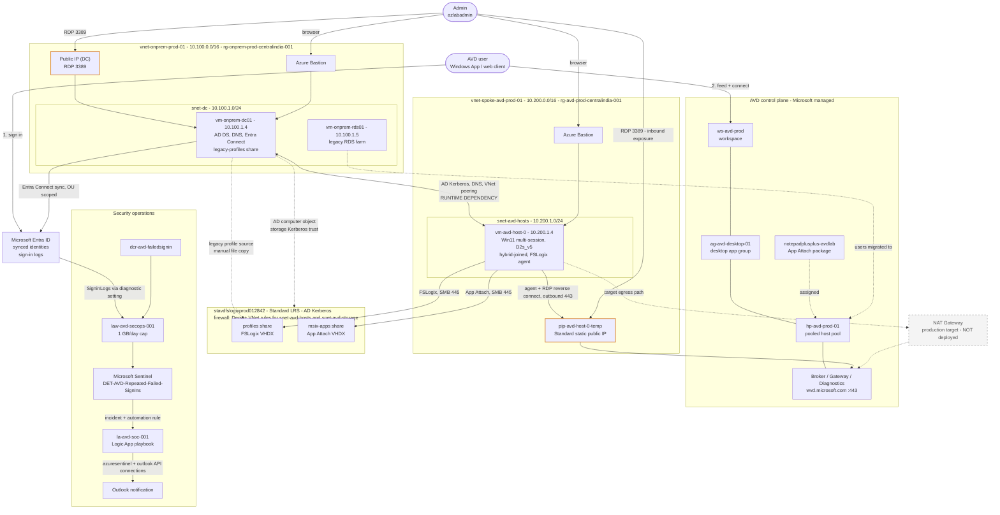
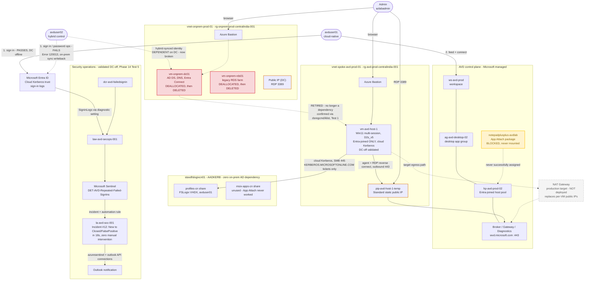

# azure-rds-avd-migration

> **RDS → Hybrid Azure Virtual Desktop → Cloud-Native AVD Identity Modernization Lab**

A simulated legacy Remote Desktop Services (RDS) environment is migrated to Azure Virtual Desktop (AVD) with hybrid Active Directory, Azure Files + AD Kerberos + FSLogix profile containers, MSIX App Attach, Conditional Access, Microsoft Sentinel/SOAR, and a planned transition toward an Entra-only AVD deployment.

Built primarily with **PowerShell**, **Azure CLI**, **Bicep** and **Git Bash**.

> **Status:** **Part 1 Complete** (Phases 1–8). 

> **Status:** **Part 2 Complete** — Cloud-native  (Phases 9–14). 

> **Project closed — infrastructure torn down 2026-10-20**
---
## Implementation Phases

| Phase | Topic | Status | Error Codes |
|---|---|---|---|
| **[01](docs/phase-1-onprem-rds-baseline/README.md)** | **onprem-rds-baseline** | **Done** | `HTTP 403.SSL` `Use .ps1`  |
| **[02](docs/phase-2-landingzone-networking/README.md)** | **landingzone-networking** | **Done** | `443` `deny` `allow`  |
| **[03](docs/phase-3-hybrid-identity/README.md)** | **hybrid-identity** | **Done** |     `SCP` `device options`  |
| **[04](docs/phase-4-azure-files-fslogix/README.md)** | **azure-Files-FSLogix** | **Done** | `SMB 445` `ACL/RBAC` `Firewall deny/allow` |
| **[05](docs/phase-5-avd-hostpool/README.md)** | **avd-hostpool** | **Done** | `Geneva` needs `assistance`   |
| **[06](docs/phase-6-migration-cutover/README.md)** | **migration-cutover** | **Done** | `0x00000001` (*Incorrect function*); `409` `AVD mslearn best practices` `dcregcmd` |
| **[07](docs/phase-7-msix-app-attach/README.md)** | **msix-app-attach** | **Done** | CIM `0x80070057` (*Invalid parameter*) `298`; `.VHDX fallback validated` `klist` `Restart-Service RDAgent & RDAgentBootloader` `path denied` `NTUSER.DAT` `RDP Properties edits in Session host on Azure portal` `Test-Path` `$LASTEXITCODE` `Domain Policy vs DC in gpmc.msc` |
| **[08](docs/phase-8-p2-secops-governance/README.md)** | **p2-secops-governance** | **Done** | `MFA` `50126` `scheduled query rule invalid` ARM/API `401` / `400` issues investigated |
| **[09](docs/9-cloud-native-identity-&-dependency-preflight/README.md)** | cloud-native-identity-&-dependency-preflight | **Done** | `403` `Property "AzureFilesIdentityBasedAuthentication" cannot be found` |
| **[10](docs/10-azure-files-entra-kerberos-migration/README.md)** | azure-files-entra-kerberos-migration | **Done** | `Update-AzStorageAccount' is not recognized....` `New-AzRoleAssignment: Operation returned an invalid status code 'ServiceUnavailable`  |
| **[11](docs/11-entra-only-AVD-FSLogix-cutover/README.md)** | entra-only-AVD-FSLogix-cutover | **Done** | `0x801c002d` `FrxStatus: 31` `Error: 1265 — ERROR_TRUST_FAILURE` `Error: 90008` |
| **[12](docs/12-application-&-cloud-native-runtime-validation/README.md)** | application-&-cloud-native-runtime-validation | **Done** | `Failed to retrieve access keys for storage accounts. Cannot proceed with AAD app attach workflow..`        `401`  (toast) → real underlying cause `403 AuthorizationFailure` (DevTools Network tab) `Owner is not an ObjectId or UPN` `400` not in JSON format |
| **[13](docs/13-domain-controller-OFF-test/README.md)** | domain-controller-OFF-test | **Done** | `0xc000006d` `0xc0000022` `Virtual Machine User Login` RBAC role, `ErrorCode 5`, `ErrorCode 13`, `ValidateRegistryImportFile failed` `FrxStatus: 31` |
| **[14](docs/14-ad-retirement-&-final-cloud-native-validation/README.md)** | ad-retirement-&-final-cloud-native-validation | **Done** | `0xc0000022 (STATUS_ACCESS_DENIED)` `120013` |
| **[15](docs/phase-15-troubleshooting/README.md)** | troubleshooting-&-cost-governance | **Done** | 	Full Issue log, #1–#14 |


## Key Engineering Investigations

Rather than assuming cloud and desktop components work out of the box, every implementation path was tested, isolated, and debugged in real time, and recorded as it actually happened — not retrofitted to look clean.

**Part 1 (hybrid):**

- **FSLogix Profile Migration:** Encountered error `0x00000001` (*Incorrect function*); resolved through registry hive load/unload validation, `NTUSER.DAT` access isolation, and container storage path adjustments.
- **MSIX CIM / App Attach Troubleshooting:** Native CIM mounting failed with driver errors `0x80070057` (`ERROR_INVALID_PARAMETER`) and semaphore lock issues (`Error 298`).
- **Storage & Driver Isolation:** Evaluated CIM mounting across driver, Windows OS version, storage permissions, and mount-path parameters before executing a fallback.
- **Fallback Package Delivery:** A VHDX-based MSIX package was created, digitally signed using `SignTool 10.0.18362.0`, uploaded to Azure Files, hash-verified, and successfully registered with AVD App Attach (`Import-AzWvdAppAttachPackageInfo` / `New-AzWvdAppAttachPackage`).
- **SOAR Payload Fixes:** Debugged API `400 Bad Request` and `401 Unauthorized` errors in Azure Logic Apps by building robust expression parsing for incident ARM IDs (`coalesce()`) and linking managed identity permissions across Sentinel workspaces.
- **Telemetry UI Propagation Delays:** Bypassed UI caching delays in the Defender / Sentinel portals by verifying raw telemetry ingestion via KQL against `SigninLogs` and deploying rules directly through PowerShell.

**Part 2 (cloud-native):**

- **Entra Kerberos admin consent gap (Phase 11):** FSLogix failed silently (`FrxStatus 31`) with zero client-side error. Root cause: the storage account's auto-created app registration never had Entra admin consent granted for `openid profile User.Read` — found only via sign-in log Error 90008 and `Test-AadkerbReadiness`, not from any UI error.
- **App Attach on Entra-only host pools (Phase 12):** `Import-AzWvdAppAttachPackageInfo` fails with an identical error across **13 independently ruled-out causes** (RBAC at every scope, firewall state, shared-key config, module version, an isolation test against a known-working storage account). Documented as an open platform question — MS Learn's stated mechanism (host device-object authentication) did not resolve it when implemented. Never reached a working state; carried forward as a known limitation through Phase 14.
- **Two-layer RBAC requirement for Entra-joined sign-in (Phase 13):** `Desktop Virtualization User` on the app group is necessary but not sufficient — a second, separate role (`Virtual Machine User Login` at VM/RG scope) is required, and its absence produces an opaque `0xc0000022` Negotiate-fallback error indistinguishable from identity corruption without this specific knowledge.
- **FSLogix containers corrupt when edited offline (Phase 13):** A reproducible finding, not a one-off — mounting a container and copying files into it outside a live, authenticated session invalidates the container's embedded registry hive (`ErrorCode 13` on next attach), even though the files remain intact at the filesystem level. Now a standing operational rule.
- **DC-off validation (Phase 14):** Confirmed via `dsregcmd`/`klist` that a cloud-native identity has zero on-prem Kerberos dependency, while a hybrid identity's password/sync plane fails outright (`Error 120013`) once its source DC is gone — the clearest possible demonstration of what AD retirement actually changes.

## Part 1 Outcome


```text
Legacy RDS
  │
  └──► AD DS / Hybrid Identity
        │
        └──► Azure Virtual Desktop
              │
              └──► Azure Files + FSLogix
                    │
                    └──► MSIX App Attach
                          │
                          └──► Conditional Access / MFA
                                │
                                └──► Microsoft Sentinel
                                      │
                                      └──► SOAR / Logic App
```
##
## What Works (Part 1)

- **Legacy RDS Migration:** Legacy RDS workload migrated to Azure Virtual Desktop.
- **Hybrid AD DS Authentication:** Domain-joined AVD session host authenticates against simulated on-premises AD DS (`vm-onprem-dc01`).
- **Profile Migration:** Legacy RDS user profile migrated into an FSLogix profile container stored on Azure Files.
- **Application Delivery:** Application delivered through AVD App Attach using a VHDX-packaged MSIX application.
- **Identity Security:** Conditional Access and MFA integrated into the AVD identity flow.
- **SIEM Detection:** Microsoft Sentinel detects repeated failed sign-ins using custom KQL and automatically creates security incidents.
- **SOAR Automation:** Sentinel automation triggers an Azure Logic App workflow that processes account entities and sends notification emails.
- **Workload Continuity:** Legacy RDS can be retired while the AVD workload remains operational.


---

## Part 2 Outcome — Cloud-Native Validation (Phases 9–14)

```text
Hybrid AVD
  │
  └──► Entra Kerberos Pilot (Phase 10)
        │
        └──► Entra-Only AVD Host + FSLogix Cutover (Phase 11)
              │
              └──► App Attach / SOAR Runtime Revalidation (Phase 12)
                    │
                    └──► Identity Migration + Profile Recovery (Phase 13)
                          │
                          └──► Domain Controller OFF Test + Retirement (Phase 14)
```

**The core question Part 2 was built to answer: can AVD operate completely independent of the on-premises Domain Controller? 

Answer: **YES**, ***for identity, profile storage, and security automation*** 

**NO**, ***not yet for App Attach, which remains an open, documented platform limitation on Entra-only host pools.***

### DC-Off Test Matrix (Phase 14 — final validation)

| # | Test | Expected | Result |
|---|---|---|---|
| 1 | Cloud-native sign-in (avduser01) | Pass | **PASS** — `dsregcmd`: `DomainJoined: NO`, `OnPremTgt: NO`, `CloudTgt: YES`; `klist` shows only Azure AD Kerberos tickets |
| 2 | Hybrid identity ops (avduser02, control) | Fail | **PASS (failed as expected)** — password sync fails with `Error 120013` once the source DC is gone |
| 3 | FSLogix mount, negative case | Fail | **Resolved analytically** — share is `AADKERB`, zero on-prem dependency; avduser02 never reaches this step |
| 4 | App Attach | — | **N/A** — never reached a working state (Phase 12); nothing to validate |
| 5 | Sentinel/SOAR automation | Still automatic | **PASS** — incident created and auto-closed `FalsePositive` in 18 seconds, DC fully offline throughout |

Full method, evidence, and reasoning for each test: [`docs/14-ad-retirement-&-final-cloud-native-validation/README.md`](docs/14-ad-retirement-&-final-cloud-native-validation/README.md).

---

## Architecture

### As-built: Part 1 (hybrid, Phases 1–8)



**Legend:** dashed grey node = target, not deployed. Orange nodes = public IPs (inbound RDP exposure). The DC-to-host arrow is a runtime dependency: with the DC off, new AVD sign-ins fail.


---

### As-built: Part 2 (cloud-native, Phases 9–14) — final state



**Legend:** dashed grey node = target, not deployed. Orange nodes = public IPs (inbound RDP exposure). Red nodes = retired (`vm-onprem-dc01`, `vm-onprem-rds01` — deallocated during testing, deleted at project close). Yellow node = documented blocked feature (App Attach, never reached a working state).

The DC-to-host dependency from Part 1 is **retired, not live** — Phase 14 confirmed via `dsregcmd`/`klist` that avduser01's sign-in, FSLogix mount, and the Sentinel/SOAR pipeline all function with the DC fully offline. The one dependency that's still real is shown as a dashed, labeled edge from avduser02 to the DC: a hybrid identity's password/sync operations fail (`Error 120013`) with no source DC to write back to — the expected, documented outcome for the control account, not a defect.

Region: Central India. Resource names match the Azure Resource Visualizer export.


---

## Known Limitations & Design Choices

- **App Attach on Entra-only host pools:** Never reached a working state across 13 independently ruled-out causes. Documented as an open platform question for Microsoft, not a configuration gap in this lab. See Phase 12 and Issue log.
- **Management Access:** Temporary public IPs were used during setup windows for administration. Production environments should enforce private administrative access via **Azure Bastion** and a **NAT Gateway** for outbound connectivity — no VM should carry a direct public IP. This was deliberately not implemented in the lab (cost/scope), but is the recommended production pattern and is shown as a planned node in both architecture diagrams above.
- **Resource Management:** Lab components were provisioned for required validation windows, deallocated between test phases, and fully deleted (both resource groups) at project close to eliminate ongoing cost — including the Phase 14 rollback snapshot, once its evidence had served its purpose and the full validation was captured on video.
- **FSLogix containers:** Must only ever be modified through a live, authenticated user session (Phase 13, Issue 11) — an offline mount-and-edit corrupts the container's registry hive validation in a way invisible at the filesystem level.

## Cost Notes

This is a learning and engineering validation lab, not a production cost model. Actual production costs depend on resource runtime, Azure Files storage tier/capacity, Sentinel log ingestion volume, NAT/Public IP usage, and licensing. Resources were deployed strictly for test windows, deallocated where possible between phases, and both resource groups were fully deleted at project close.

## Repository Layout

```text
azure-avd-rds-migration/
│
├── docs/
│   ├── phase-1-onprem-rds-baseline/
│   ├── phase-2-landingzone-networking/
│   ├── phase-3-hybrid-identity/
│   ├── phase-4-azure-files-fslogix/
│   ├── phase-5-avd-hostpool/
│   ├── phase-6-migration-cutover/
│   ├── phase-7-msix-app-attach/
│   ├── phase-8-p2-secops-governance/
│   ├── 9-cloud-native-identity-&-dependency-preflight/
│   ├── 10-azure-files-entra-kerberos-migration/
│   ├── 11-entra-only-AVD-FSLogix-cutover/
│   ├── 12-application-&-cloud-native-runtime-validation/
│   ├── 13-domain-controller-OFF-test/
│   ├── 14-ad-retirement-&-final-cloud-native-validation/
│   └── phase-15-troubleshooting/
│
├── images/
│   ├── phase-1/ ... phase-8/
│   └── phase-9/ ... phase-14/
│
├── scripts/
│   ├── powershell/
│   └── bash/
│
└── README.md
```

Each phase directory contains its own implementation notes, CLI/PowerShell execution commands, screenshot evidence, KQL queries, and root-cause troubleshooting logs.

## Conclusion & Engineering Philosophy

The repository documents both the as-built implementation and every real deviation from the original plan. Results are recorded as **validated, failed, workaround, or planned** rather than presenting the original design as if every component worked exactly as intended — Phase 12's App Attach entry and Phase 13's two mid-migration incidents are left in as found, not smoothed over.

When portal dashboards experience propagation delays or return misleading UI state, verification relies on low-level evidence:

> ***Trust the logs. Trust KQL. Trust PowerShell. Follow the evidence.***

---

**Entire Phase 14 Speedrun** 


