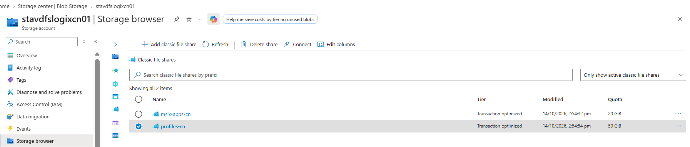
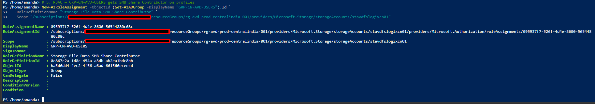
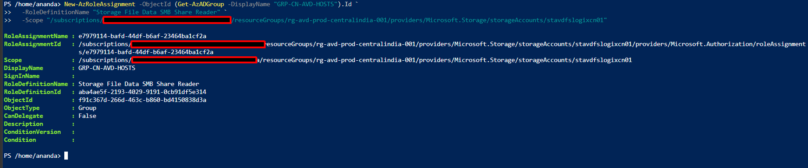

# Phase 10: Azure Files Entra Kerberos migration

## Objective
Stand up a new, cloud-native Azure Files share using Microsoft Entra Kerberos for authentication, with RBAC-only access control for the cloud-only identities created in Phase 9. The existing AD-Kerberos storage account is left untouched, so Part 1 evidence and rollback are unaffected regardless of Part 2 outcome.

## Prerequisites
- Phase 9 complete: AD dependency inventory done, `cnuser01`/`cnuser02` and `GRP-CN-AVD-USERS` exist as cloud-only identities.
- `Az.Storage` module present (tested on 9.7.2 — see note below on cmdlet/verification gotchas for this version).
- Azure CLI available (used for verification where the installed `Az.Storage` version doesn't surface the identity-based-auth property).

## Steps

### 1. Create a new storage account
A storage account's `directoryServiceOptions` is a single value (AD, AADKERB, or AADDS) and cannot be mixed — migrating in place would mean dropping AD support before Entra Kerberos is proven. A new account avoids that risk and preserves rollback.
```powershell
New-AzStorageAccount -ResourceGroupName rg-avd-prod-centralindia-001 `
  -Name stavdfslogixcn01 -Location centralindia -SkuName Standard_LRS -Kind StorageV2
```

### 2. Enable Microsoft Entra Kerberos
```powershell
Set-AzStorageAccount -ResourceGroupName rg-avd-prod-centralindia-001 `
  -Name stavdfslogixcn01 -EnableAzureActiveDirectoryKerberosForFile $true
```

### 3. Verify the identity source
```powershell
az storage account show --name stavdfslogixcn01 --resource-group rg-avd-prod-centralindia-001 `
  --query "azureFilesIdentityBasedAuthentication"
```
Expect `directoryServiceOptions: "AADKERB"` and `activeDirectoryProperties: null`.

### 4. Create shares
```powershell
$ctx = (Get-AzStorageAccount -ResourceGroupName rg-avd-prod-centralindia-001 -Name stavdfslogixcn01).Context
New-AzStorageShare -Name profiles-cn -Context $ctx
New-AzStorageShare -Name msix-apps-cn -Context $ctx
```
Quotas set at creation: `profiles-cn` 50 GB, `msix-apps-cn` 20 GB (default is 100 TB; reduced for a lab-scale deployment).

### 5. RBAC for the profiles share
```powershell
New-AzRoleAssignment -ObjectId (Get-AzADGroup -DisplayName "GRP-CN-AVD-USERS").Id `
  -RoleDefinitionName "Storage File Data SMB Share Contributor" `
  -Scope "/subscriptions/41a2b403-5b13-4a58-8cc0-c3ec75dba78a/resourceGroups/rg-avd-prod-centralindia-001/providers/Microsoft.Storage/storageAccounts/stavdfslogixcn01"
```

### 6. Create the cloud-native hosts group and assign Reader RBAC
No cloud-native equivalent of `grp-avd-hosts` existed yet; created here for the `msix-apps-cn` share.
```powershell
New-AzADGroup -DisplayName "GRP-CN-AVD-HOSTS" -MailNickname "GRP-CN-AVD-HOSTS"

New-AzRoleAssignment -ObjectId (Get-AzADGroup -DisplayName "GRP-CN-AVD-HOSTS").Id `
  -RoleDefinitionName "Storage File Data SMB Share Reader" `
  -Scope "/subscriptions/41a2b403-5b13-4a58-8cc0-c3ec75dba78a/resourceGroups/rg-avd-prod-centralindia-001/providers/Microsoft.Storage/storageAccounts/stavdfslogixcn01"
```
`GRP-CN-AVD-HOSTS` has no members yet — the future Entra-joined session host's computer object is added in Phase 11.

## Verification
```powershell
Get-AzRoleAssignment -Scope "/subscriptions/41a2b403-5b13-4a58-8cc0-c3ec75dba78a/resourceGroups/rg-avd-prod-centralindia-001/providers/Microsoft.Storage/storageAccounts/stavdfslogixcn01" |
  Select-Object DisplayName, RoleDefinitionName
```
Expected:
```
GRP-CN-AVD-USERS   Storage File Data SMB Share Contributor
GRP-CN-AVD-HOSTS   Storage File Data SMB Share Reader
```
- `stavdfslogixcn01.AzureFilesIdentityBasedAuthentication.directoryServiceOptions` = `AADKERB`, `activeDirectoryProperties` = `null`.
- No NTFS ACL step was required or performed — Entra Kerberos share access is RBAC-only, replacing the `CONTOSO\GRP-AVD-USERS:(M)` NTFS model used on the AD-Kerberos account.
- Old storage account `stavdfslogixprod012842` unchanged (verified no modification made).

## Known issues / module gotchas
- `Update-AzStorageAccount` does not exist; the correct cmdlet is `Set-AzStorageAccount`.
- On `Az.Storage 9.7.2`, `Get-AzStorageAccount` (with or without `-IncludeIdentityBasedAuthentication`, which isn't a valid parameter on this version) does not reliably return `AzureFilesIdentityBasedAuthentication`. Verified instead via `az storage account show --query`.
- `New-AzRoleAssignment` against a just-created Entra group can return `ServiceUnavailable` on the first attempt — this is Entra→Azure RBAC propagation lag, not a configuration error. Retry after a short wait.

## Decision
Phase 10 complete. New storage account is fully cloud-native (`AADKERB`, no AD properties), shares created, RBAC assigned to both cloud-native groups. Proceed to Phase 11 (Entra-only AVD host + FSLogix cutover to `profiles-cn`).

## Evidence checklist
- [x] 
  
- [x] 
  
- [x] 
  
- [x] 

