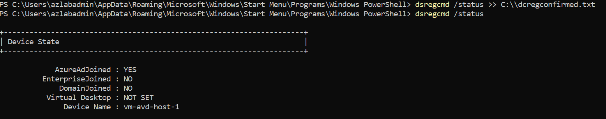
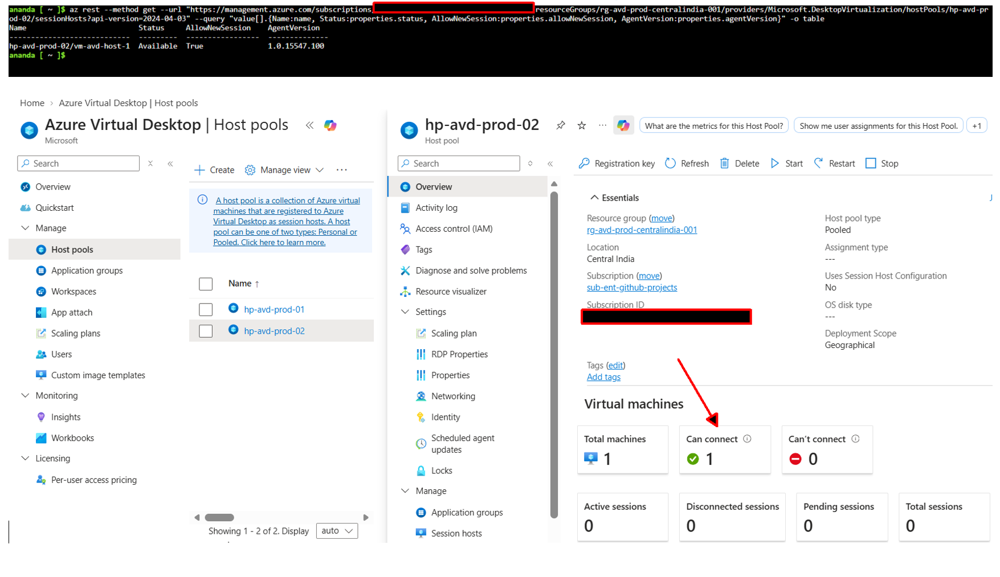
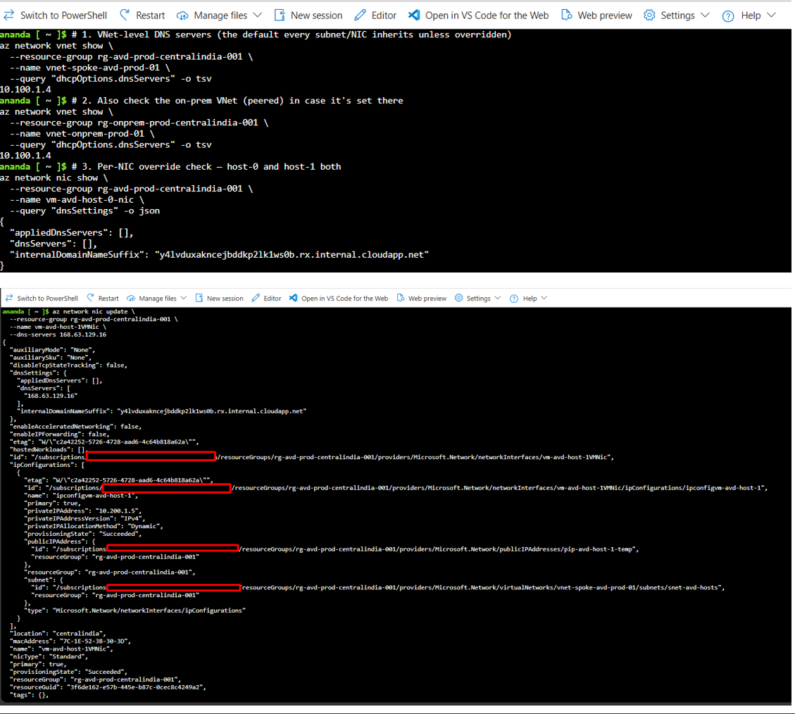
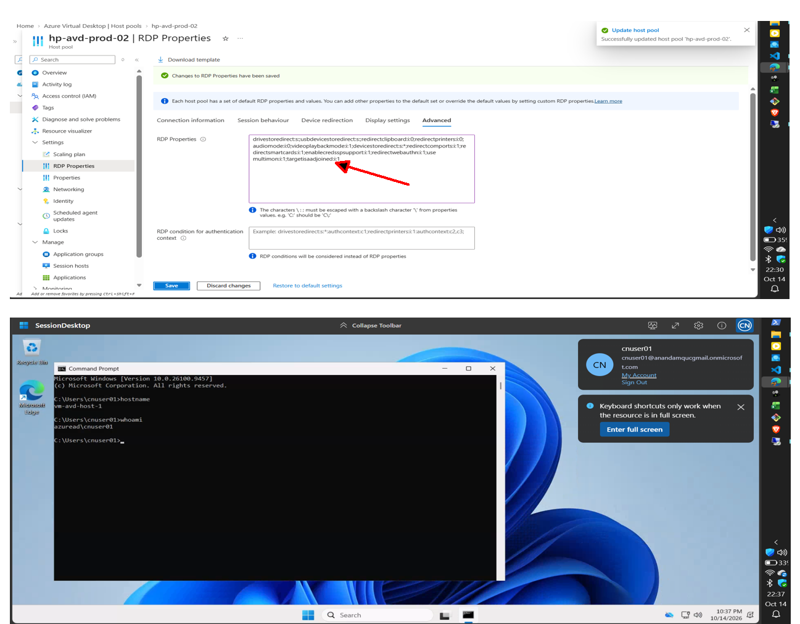
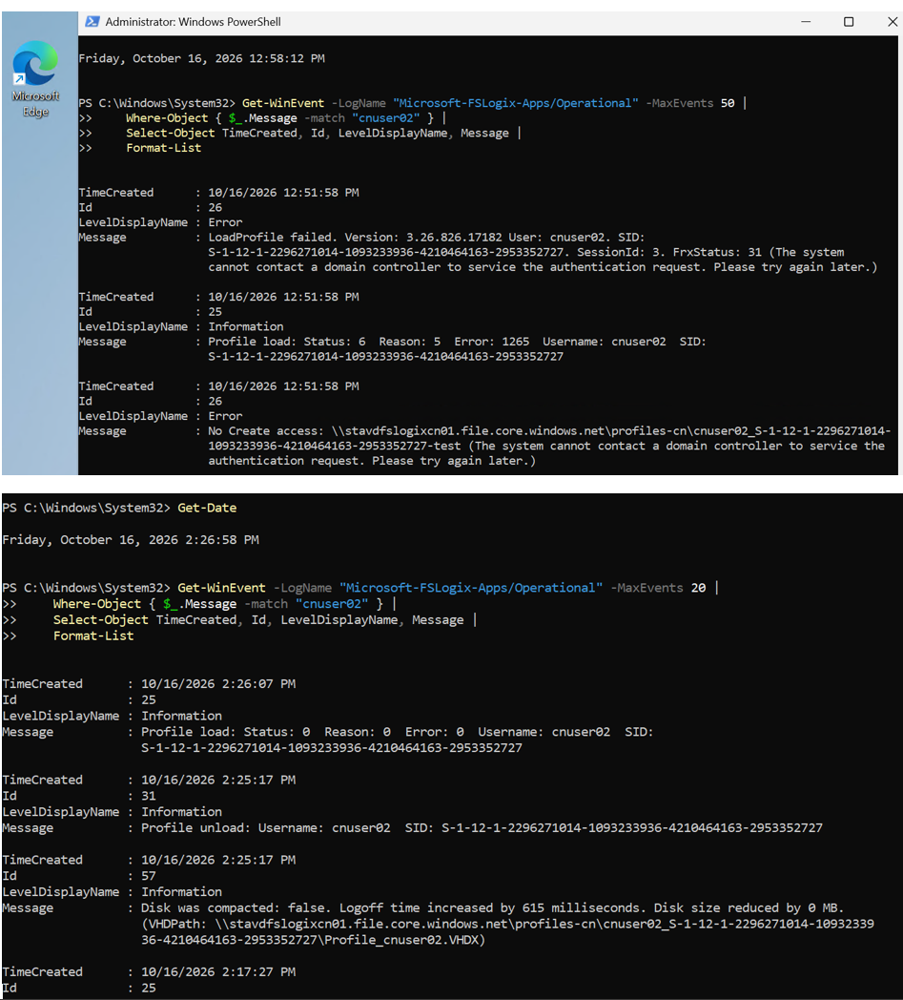
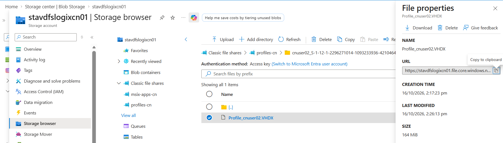
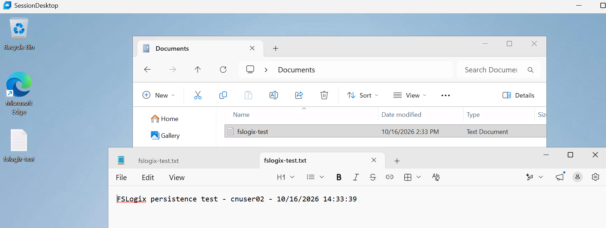
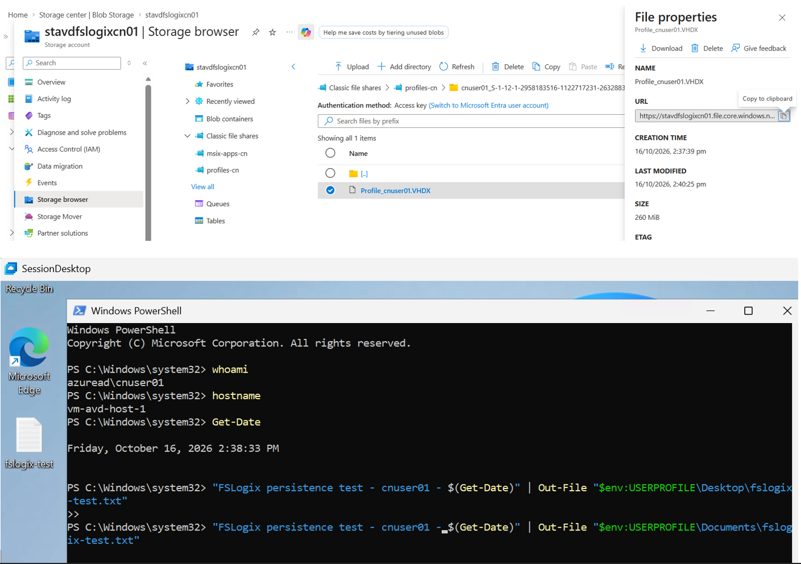

# Phase 11: Entra-Only AVD + FSLogix Cutover

## Objective
Prove that FSLogix profile containers can run entirely on Microsoft Entra ID identity — no AD DS, no hybrid sync, no on-prem domain controller — against Azure Files using Microsoft Entra Kerberos. This is the core test of Part 2's goal: removing the AD DS dependency from the AVD stack, not just migrating workloads onto cloud storage.

## Prerequisites
- Phase 9 complete: cloud-only test users `cnuser01`/`cnuser02` and group `GRP-CN-AVD-USERS` created; storage account identity model confirmed (legacy AD on the Part 1 account).
- Phase 10 complete: new storage account `stavdfslogixcn01` created with `directoryServiceOptions: AADKERB`, shares `profiles-cn` (50 GB) and `msix-apps-cn` (20 GB), RBAC assigned to `GRP-CN-AVD-USERS`.
- A session host that is Entra-joined only (no domain join).

## Steps

1. Deploy `vm-avd-host-1` (Standard_D2s_v5, IST timezone, public IP) as Entra-joined only — no `Add-Computer`, no on-prem OU.
2. Fix Entra join if `az vm create` doesn't attach a system-assigned managed identity by default:
   ```powershell
   az vm identity assign --name vm-avd-host-1 --resource-group rg-avd-prod-centralindia-001
   ```
   Reboot, then confirm with `dsregcmd /status` → `AzureAdJoined: YES`.
3. Override the host's per-NIC DNS to Azure DNS only (`168.63.129.16`) so it doesn't inherit the VNet default DNS (the on-prem DC at `10.100.1.4`), keeping the host DC-independent.
4. Confirm FSLogix is present (pre-installed on the `win11-24h2-avd-m365` marketplace image). Apply the Cloud Kerberos registry keys (see `phase11-setup.ps1`) and point `VHDLocations` at `profiles-cn`.
5. Create a new application group `ag-avd-desktop-02` (Desktop type), bind it to `hp-avd-prod-02`, associate it to the existing workspace `ws-avd-prod`.
6. Assign `Desktop Virtualization User` to `cnuser01`/`cnuser02` (and `GRP-CN-AVD-HOSTS`) on `ag-avd-desktop-02`; assign `Virtual Machine User Login` to the same users scoped to `vm-avd-host-1`.
7. Add the custom RDP property `targetisaadjoined:i:1` to `hp-avd-prod-02` — required for Entra-joined-only session hosts; sign-in fails with a generic credential error without it.
8. Set the storage account's default share permission (mandatory for cloud-only identities — per-user RBAC alone is not sufficient):
   ```powershell
   az storage account update --name stavdfslogixcn01 --resource-group rg-avd-prod-centralindia-001 --default-share-permission StorageFileDataSmbShareContributor
   ```
9. Tag the storage account's auto-created service principal and application registration with `kdc_enable_cloud_group_sids` (mandatory for cloud-only identity support):
   ```powershell
   $sp = Get-AzADServicePrincipal -ApplicationId "<storage-app-id>"
   Update-AzADServicePrincipal -ObjectId $sp.Id -Tag @("WindowsAzureActiveDirectoryIntegratedApp","kdc_enable_cloud_group_sids")
   ```
10. **Grant Entra admin consent on the storage account's app registration.** This is the step every doc and walkthrough omits, and it is mandatory — ticket issuance silently fails without it, with no error surfaced client-side:
    ```powershell
    az ad app permission admin-consent --id <storage-app-id>
    ```
11. Sign out and fully sign back in as the cloud-only user (a token refresh is required to pick up the new consent grant — `klist purge` alone does not).
12. Test the mount directly before relying on FSLogix, to isolate SMB/Kerberos from FSLogix-specific issues:
    ```cmd
    net use Z: \\stavdfslogixcn01.file.core.windows.net\profiles-cn
    ```
13. Sign in through the normal AVD session (Windows App client) and confirm FSLogix mounts the profile automatically.

## Portal steps (equivalent to the CLI steps above)

1. **Deploy vm-avd-host-1**: Portal → Virtual machines → Create → select image `win11-24h2-avd-m365`, size `Standard_D2s_v5`, region Central India. Under Networking, attach to `snet-avd-hosts`. Under Management, leave domain join unchecked (Entra-joined only is the default for a plain VM create — do not run any AD join step). Under Identity tab (if present at creation) or after creation → **Identity** blade → System assigned → On → Save. This is the portal equivalent of `az vm identity assign`.

2. **DNS override**: VM blade → Networking → click the NIC → DNS servers → switch from "Inherit from virtual network" to **Custom**, enter `168.63.129.16` only → Save. Reboot the VM from the Overview blade.

3. **App group and pool wiring**: Azure Virtual Desktop → Host pools → **Create** → name `hp-avd-prod-02`, Host pool type Pooled, Load balancing Breadth-first → Next: Virtual Machines (skip, host already exists, or add `vm-avd-host-1` here if creating fresh) → Next: Workspace → select existing `ws-avd-prod` → Create.
   Then: Host pools → `hp-avd-prod-02` → Application groups → **Add** → Desktop application group → name `ag-avd-desktop-02` → confirm it's linked to `ws-avd-prod`.

4. **RBAC assignment on the app group**: `ag-avd-desktop-02` → Access control (IAM) → Add role assignment → role **Desktop Virtualization User** → assign to `cnuser01`, `cnuser02` (or the group `GRP-CN-AVD-USERS`).

5. **Custom RDP property**: Host pools → `hp-avd-prod-02` → Properties (or RDP Properties blade) → **Show advanced properties** → add `targetisaadjoined:i:1` to the custom RDP property string → Save.

6. **Storage default share permission**: Storage accounts → `stavdfslogixcn01` → **File shares** → Active Directory (left nav, shown since AADKERB is the identity source) → confirm Directory service is AADKERB → the **default share permission** field is set here in the portal under this same blade → select `Storage File Data SMB Share Contributor` → Save.
   (If this field isn't visible in your portal version, it's set only via `az storage account update --default-share-permission` — the CLI command in `phase11-setup.ps1` is the reliable path.)

7. **RBAC for cloud groups on the share**: Storage accounts → `stavdfslogixcn01` → Containers/File shares → `profiles-cn` → Access control (IAM) → Add role assignment → **Storage File Data SMB Share Contributor** → assign to `GRP-CN-AVD-USERS`.

8. **Service principal tag and admin consent — NOT available in the Azure portal.** These two steps (`kdc_enable_cloud_group_sids` tag, and `az ad app permission admin-consent`) have no portal equivalent for this specific auto-created storage app registration — it does not appear as a normal entry under Entra ID → App registrations (it's a first-party, hidden service principal). Both must be done via PowerShell/CLI as shown in `phase11-setup.ps1`, Sections 2 and 3. This is worth calling out explicitly in the README as a portal limitation, not an oversight — it's also why this root cause was so hard to find: there was no portal surface that would have ever shown you this gap.

9. **Registry keys**: no portal equivalent — these are local machine state, set via Group Policy, Intune/MDM, or direct registry edit as shown in Section 4 of the script. Portal has no reach into session host local registry.

## Verification
```powershell
# On the host, as the test user — confirm device & Kerberos state
dsregcmd /status
klist cloud_debug

# As admin, confirm the FSLogix mount outcome
Get-WinEvent -LogName "Microsoft-FSLogix-Apps/Operational" -MaxEvents 20 |
    Where-Object { $_.Message -match "cnuser02" } |
    Select-Object TimeCreated, Id, LevelDisplayName, Message |
    Format-List
```
- `dsregcmd /status` shows `AzureAdJoined: YES`, `AzureAdPrt: YES`, `CloudTgt: YES`.
- FSLogix event log shows `Profile load: Status: 0  Reason: 0  Error: 0` for the test user.
- VHDX exists at `\\stavdfslogixcn01.file.core.windows.net\profiles-cn\<user>_<SID>\Profile_<user>.VHDX`, visible in Storage Browser.
- Profile persists across sign-out/sign-in and host reboot (confirmed with marker files in Desktop/Documents).
- Clean unload/compact event on logoff.

## Evidence checklist
- [x] 
  
- [x] 
  
- [x] 
  
- [x] 
  
- [x] 
  
- [x] 
  
- [x] 
  
- [x] 
