# Phase 12 — Application & Cloud-Native Runtime Validation

**Scope:** Revalidate App Attach and Sentinel/SOAR against the Entra-only host pool (`hp-avd-prod-02`) and cloud-only identities (`cnuser01`/`cnuser02`), built in Phase 11.

**Status:** Sentinel/SOAR — **DONE**, fully automatic end-to-end confirmed. App Attach — **BLOCKED**, documented as known limitation, MS support case drafted (not filed).

---

## Part A — App Attach (BLOCKED)

### Goal
Deploy a new App Attach package (Notepad++, MSIX) to `hp-avd-prod-02`, targeting a new storage account/share (`stavdfslogixcn01/msix-apps-cn`), assigned to `GRP-CN-AVD-USERS`.

### What was done
1. Granted **Reader and Data Access** RBAC to both AVD first-party service principals (`Azure Virtual Desktop`, `Azure Virtual Desktop ARM Provider`) at the `msix-apps-cn` share scope, then at the storage account scope.
2. Cross-share VHDX copy: `stavdfslogixprod012842/msix-apps` → `stavdfslogixcn01/msix-apps-cn/NotepadPlusPlus/NotepadPlusPlus/NotepadPlusPlus.vhdx`.
3. Attempted `Import-AzWvdAppAttachPackageInfo` against `hp-avd-prod-02` from `vm-avd-host-1`.

### Result
Persistent, byte-identical error on every attempt:
```
Failed to retrieve access keys for storage accounts. Cannot proceed with AAD app attach workflow.
```

### 13 causes ruled out (confirmed NOT the blocker)
| # | Area | What was tried |
|---|---|---|
| 1 | RBAC | AVD SPs — Reader and Data Access at share scope |
| 2 | RBAC | AVD SPs — Reader and Data Access at storage account scope |
| 3 | Shared key | `allowSharedKeyAccess` forced to `$true` |
| 4 | RBAC | Host VM managed identity — Storage Account Key Operator Service Role |
| 5 | Firewall | `networkRuleSet.bypass = AzureServices` |
| 6 | Firewall | `DefaultAction = Allow` (fully open) |
| 7 | Firewall | Re-tested after re-tightening to `Deny` |
| 8 | RBAC | Admin user — confirmed Owner + Contributor already present |
| 9 | Network | Admin's public IP confirmed correctly allow-listed |
| 10 | Entry point | Portal wizard UNC-path input (bypassing broken file-picker) — identical error |
| 11 | Identity | PRT/Kerberos for `cnuser02` — confirmed healthy (`AzureAdPrt: YES`, `CloudTgt: YES`) |
| 12 | RBAC | Host **device object** added to `GRP-CN-AVD-HOSTS`, granted Storage File Data SMB Share Reader |
| 13 | Module | `Az.DesktopVirtualization` confirmed 6.0.0 (doc requires 4.2.1+) |

**Isolation test:** same command, same host pool, against the **old, proven-working** storage account (`stavdfslogixprod012842`) — identical error. This rules out anything specific to the new storage account and confirms the blocker is structural to **App Attach import + Entra-only host pool**, not RBAC/firewall/key config.

### Two separate bugs found along the way
- **Portal file-picker bug:** browsing the file share in the App Attach wizard throws portal-level `401`; DevTools Network tab shows the real failure is `403 AuthorizationFailure` on the Azure Files data-plane list call — a UI bug, unrelated to the import failure itself (proven by bypassing it with UNC input, which still fails with the original error).
- **PRT red herring:** testing with `azlabadmin` (legacy on-prem admin, never meant to get a PRT on an Entra-only host) showed `AzureAdPrt: NO` — expected and irrelevant. Re-tested with the real intended identity `cnuser02` — PRT and CloudTgt both healthy.

### Current best-documented root cause (unconfirmed by Microsoft)
Per MS Learn (`app-attach-overview`, Azure Files section): *"VHDX or CimFS disk images are mounted using the **computer account of the session host**."* This means the expand/mount step authenticates as the host's own Entra **device/computer object** — not the AVD SPs (already correctly scoped), not the admin, not a user's PRT. Granting this (device object added to `GRP-CN-AVD-HOSTS`, group granted Storage File Data SMB Share Reader) did **not** resolve it — so either the correct permission/role for the device identity is different, or there's a separate platform-level gap on Entra-only pools.

### Status: open MS support case (drafted, not filed)
Severity B · Service: Azure Virtual Desktop · Problem type: App Attach. Includes full repro, exact error text, all 13 ruled-out causes, and the open question: *is App Attach import supported end-to-end on an Entra-joined-only (non-hybrid) host pool, and if so what identity does the expand/import step actually authenticate as?*

**Decision:** documented as a known limitation. Not blocking Phase 13/14.

---

## Part B — Sentinel/SOAR Revalidation (COMPLETE)

### Goal
Re-run the existing Phase 8 detect → incident → triage → close loop against cloud-only identities (`cnuser01`/`cnuser02`) on `hp-avd-prod-02`. No rebuild — workspace, analytics rule, Logic App, and automation rule all pre-exist from Phase 8.

### Components (unchanged from Phase 8)
- Workspace: `law-avd-secops-001`
- Analytics rule: `DET-AVD-Repeated-Failed-SignIns` (resource name `af9a201c-7b3a-40ba-b9d4-9bc9b96f6524`)
- Logic App: `la-avd-soc-001`
- Automation rule: `AUTO-AVD-FailedSignIn-SOAR` (id `b11b7e4e-348d-47a5-9705-7ab1fd5d9184`)

### Discovery: playbook had been silently descoped
The deployed playbook was notify-only (trigger → debug → entities → email), with no close/classify step — a prior simplification after hitting bugs with the V3 "Add comment" action. This explained incidents sitting at `New` with empty `Labels` despite email notifications always firing successfully.

### RBAC gap found and fixed
`suadmin@anandamqucgmail.onmicrosoft.com` — the identity behind the Logic App's `azuresentinel` API connection — had **zero Sentinel role on the workspace itself**. Automation Contributor on the resource group governs whether Sentinel's service can *invoke* the playbook; it does **not** grant the connection's own identity rights to call Update Incident. Fix: granted **Microsoft Sentinel Responder** on `law-avd-secops-001` to `suadmin`.

### Playbook rebuilt (V2-only, avoiding V3 bugs)
New flow: `Sentinel incident trigger` → `Update_incident (V2)` → `Send an email (V2)`. Single V2 action handles close + classification + comment + tags in one call.

### Three real bugs found and fixed (in order)
1. **Stray whitespace after `@`** — `"@   triggerBody()?['object']?['id']"` (three literal spaces) was parsed as a string literal, not an expression, so it always evaluated to nothing. Fix: no whitespace between `@` and the expression.
2. **Invalid owner assignment** — `"ownerAction": "Assign"` with `"owner": null` fails validation (`Owner is not an ObjectId or UPN`). Fix: changed to `"ownerAction": "Unassign"`, removed the `owner` field.
3. **Tag shape** — `tagsToAdd.TagsToAdd` must be an array of `{"Tag": "value"}` objects, not plain strings, to actually persist as incident labels.

### Debugging technique (keep for future Logic App work)
Logic Apps run-history action-level `status`/`error` fields are frequently empty/null for `ApiConnection` action failures. The real HTTP status and body are only visible by pulling `outputsLink.uri` (response) or `inputsLink.uri` (actual post-expression request body) and `curl`-ing them directly. This was the only way every real error in this phase was diagnosed.

### False leads (ruled out, worth knowing about)
- Sentinel's own **"Missing permissions" badge** on the automation rule (and the "Logic Apps playbooks now require an updated permission" banner) is a **stale/cached portal UI check**, not reality — confirmed via direct ARM GET that both the correct SP (`Azure Security Insights`, Automation Contributor) and the automation rule itself were correctly configured the entire time.
- Manually clicking **"Run Trigger"** in the Logic App designer sends an **empty HTTP body** (`Content-Length: 0`) — not a valid test method, produces a misleading "Incident Arm id missing" error unrelated to any real bug. Correct manual test: Sentinel Incidents blade → open incident → **Actions → Run playbook**.
- **Defender portal incident numbers** (`security.microsoft.com/incidents/N`) do not match Sentinel-native `SecurityIncident` table `IncidentNumber` for the same incident (Defender renumbers/unifies across sources) — e.g., Defender's incident 19 = Sentinel's incident 9. Not a real discrepancy, just two numbering schemes.

### Final confirmed result — fully automatic, zero manual intervention
| Event | Time (18 Oct 2026) |
|---|---|
| 3rd failed sign-in (`cnuser02`) | 14:26:12 |
| Logic App run auto-started | 14:37:52 |
| `Update_incident` succeeded | +6.56s |
| `Send_an_email_(V2)` succeeded | +487ms |
| Confirmation email received | 14:38 |

No "Run playbook" or "Run Trigger" click involved — the automation rule fired the playbook automatically on incident creation, consistent with the rule's 5-minute scheduled evaluation cadence. Incident confirmed via KQL: `Status: Closed`, `Classification: FalsePositive`, all 4 labels present (`SOC-Simulation`, `MITRE-T1110`, `FalsePositive-Test`, `AVD-Lab`).

### Discrepancy to flag
Earlier documentation text says the detection threshold is `>=5` failed sign-ins; the actual **deployed** rule is `>=3` within a 10-minute window. Deployed config is correct/working as-is — just update the written description to match.

---

## Screenshots (evidence checklist)

### App Attach
- [x] 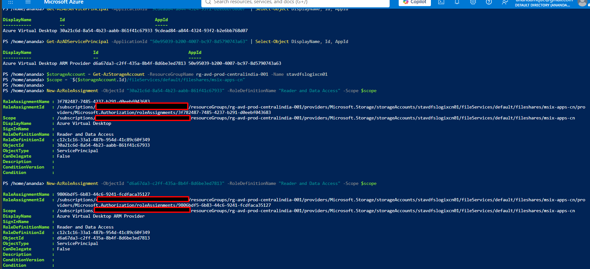
  
- [x] 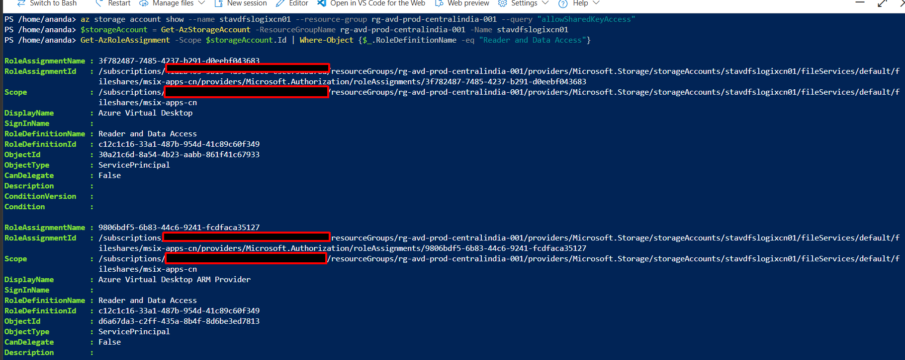
  
- [x] 
  
- [x] 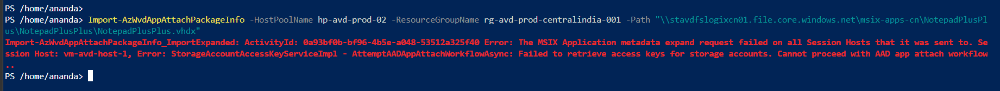
  
- [x] 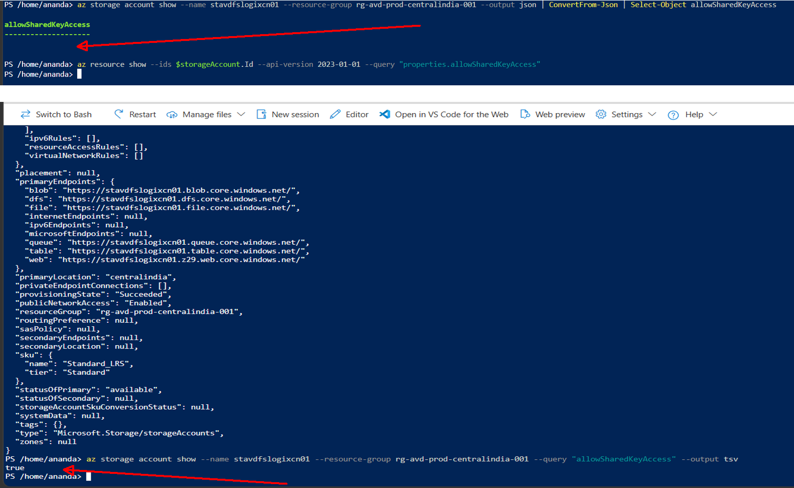
  
- [x] 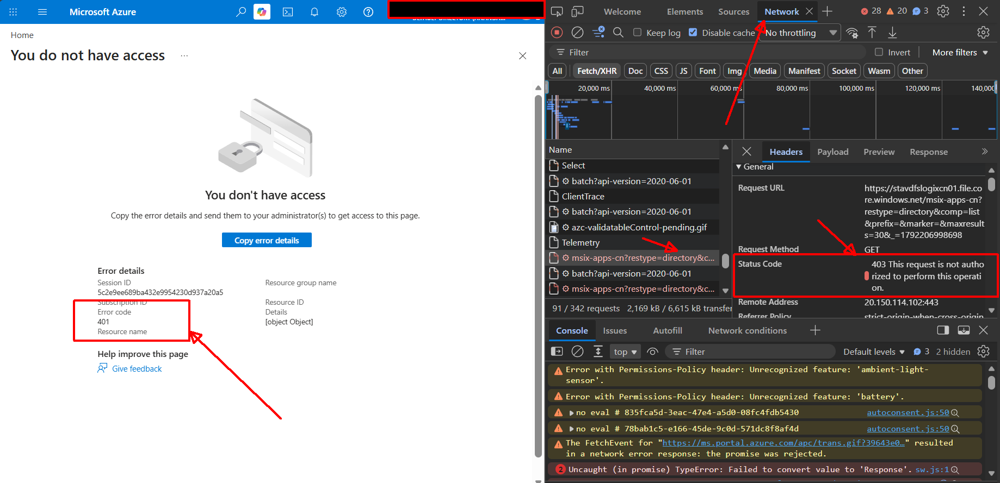
  
- [x] 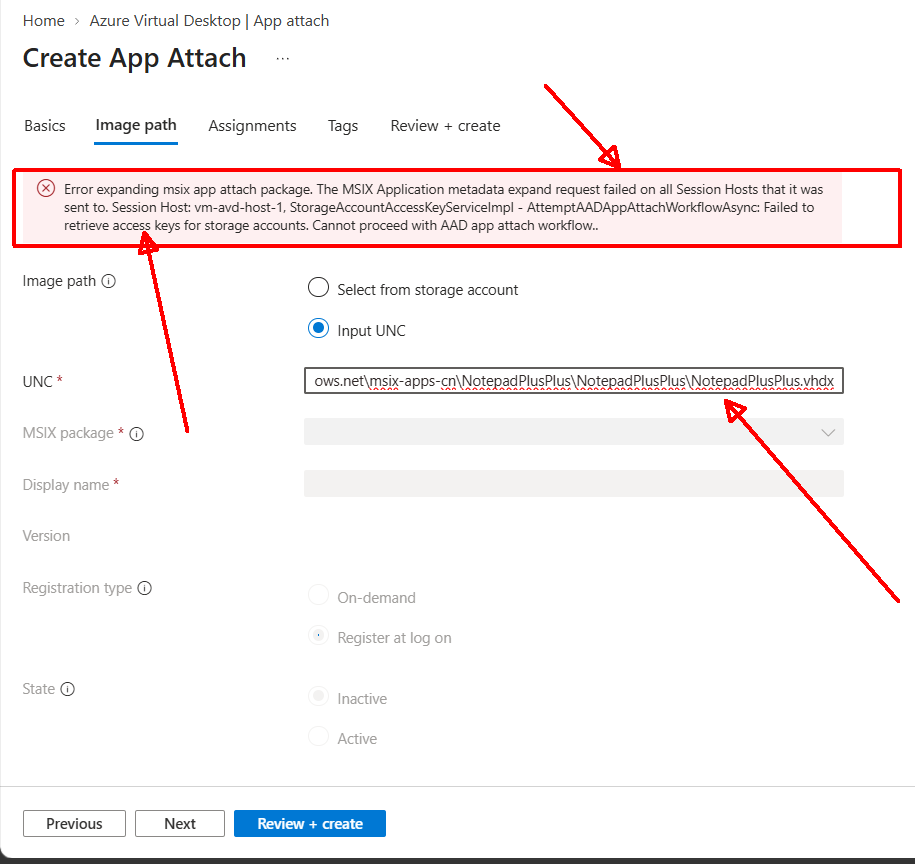
  
- [x] 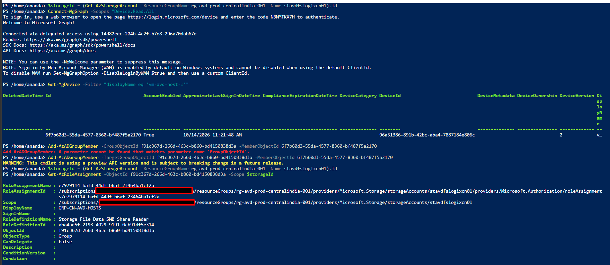
  
- [x] 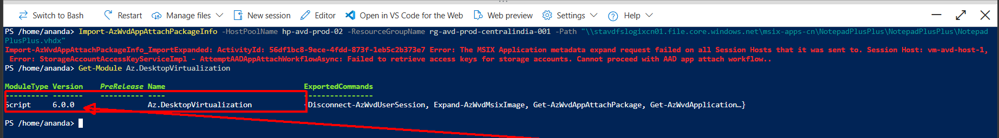
  
- [x] 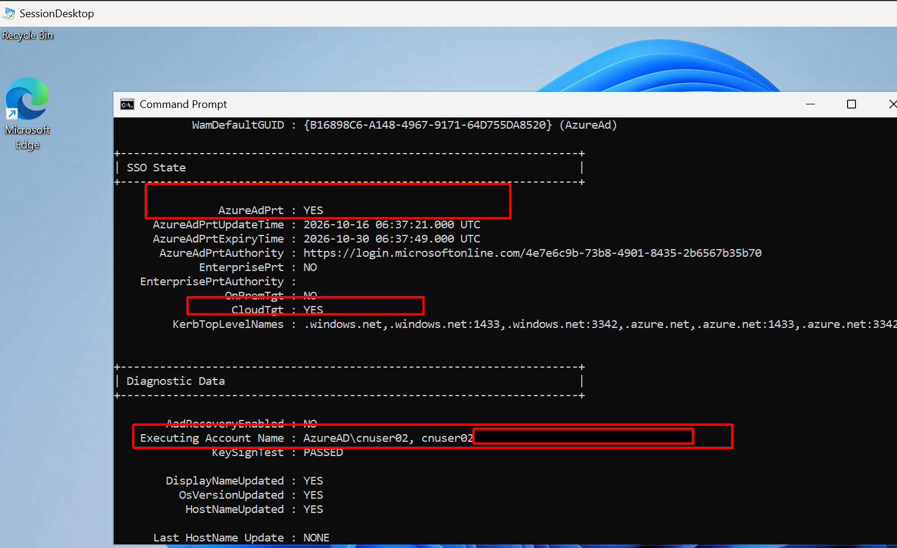
  
- [x] 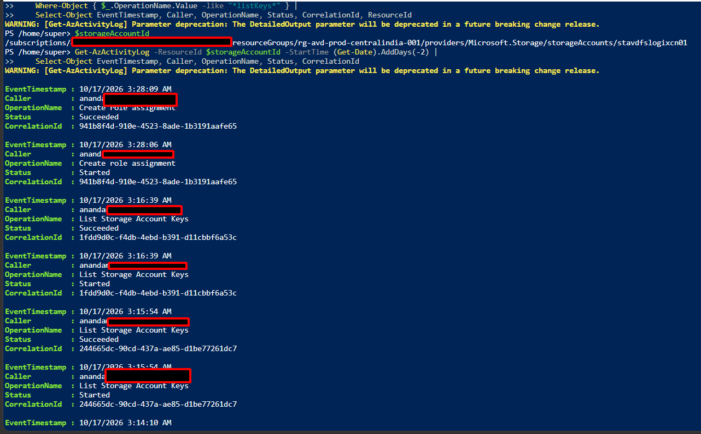 

- [x] **[MS support case draft](../evidence/MSFT%20support%20case%20full%20draft.md)**

### Sentinel/SOAR
- [x] 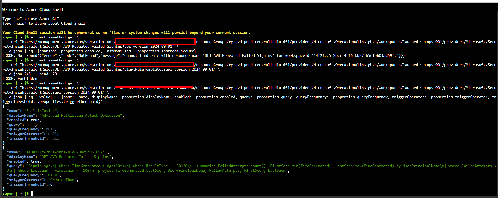
  
- [x] 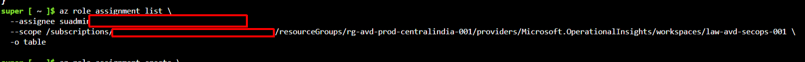
  
- [x] 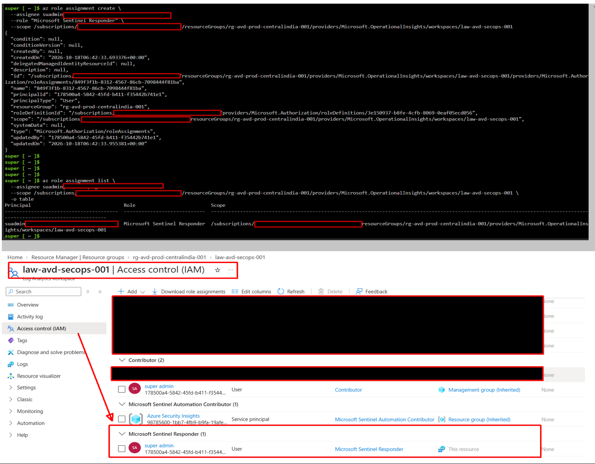
    
- [x] 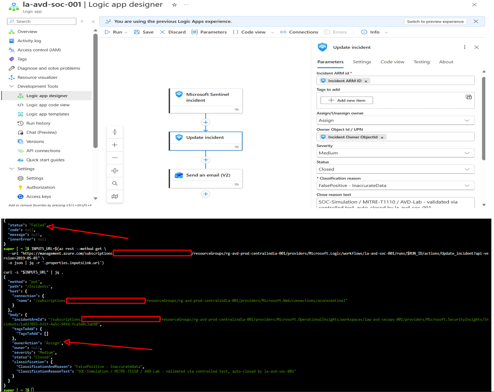
  
- [x] 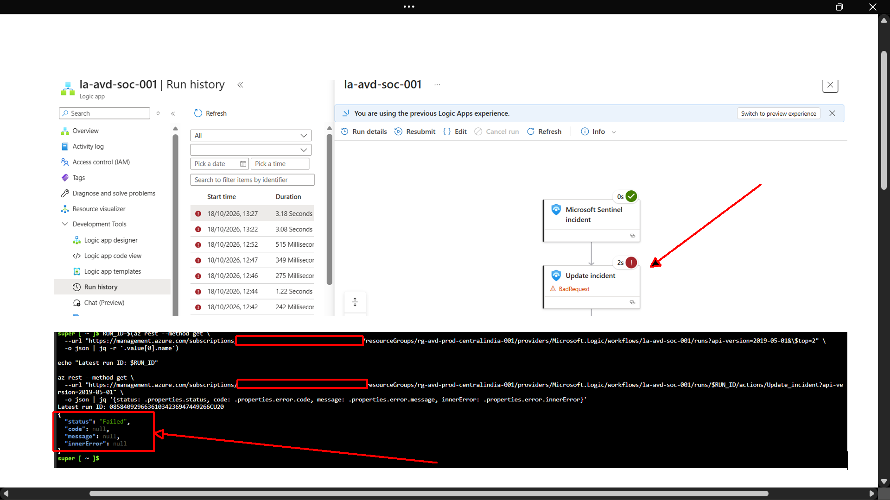 
  
- [x]  
  
- [x] 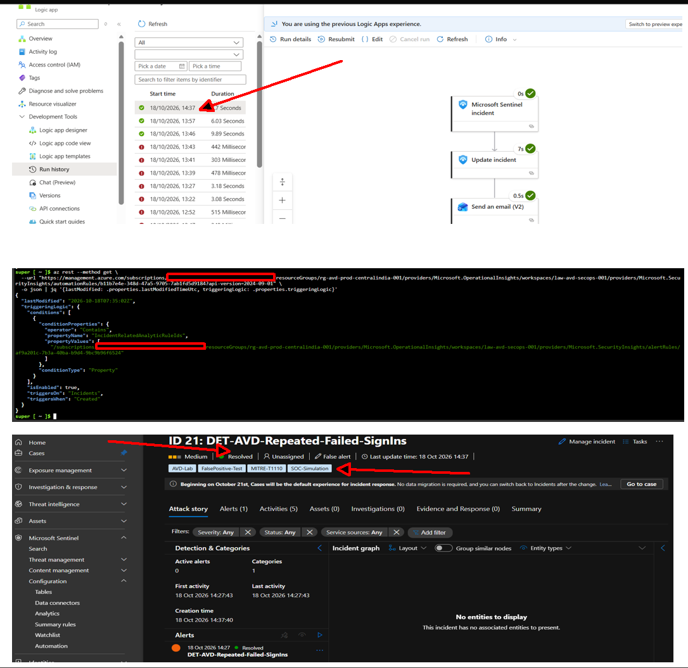 
  
- [x] 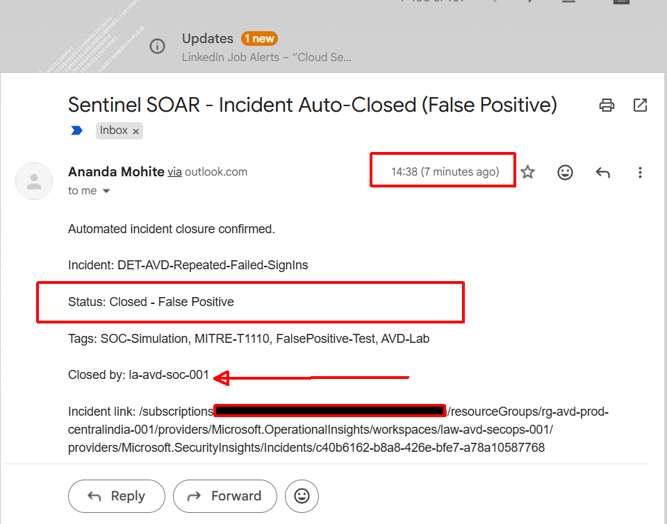
  
---

## Lessons learned (for main project README)

1. App Attach import on an Entra-only (non-hybrid) host pool is **not confirmed working** even with all documented RBAC correctly in place — treat as an open platform question, not a config mistake, if you hit the same error.
2. Logic Apps' `ApiConnection` action error reporting is unreliable in run history — always pull the raw `outputsLink`/`inputsLink` payload via API, don't trust the designer's green/red checkmark alone.
3. A single stray space after `@` in a Logic Apps expression silently degrades to a string literal — no syntax error, just a wrong runtime result.
4. Sentinel's "Missing permissions" UI badges can be stale/cached — verify via direct ARM GET before assuming a real gap.
5. Defender portal incident IDs and native Sentinel `IncidentNumber` are different numbering schemes for the same incident.
