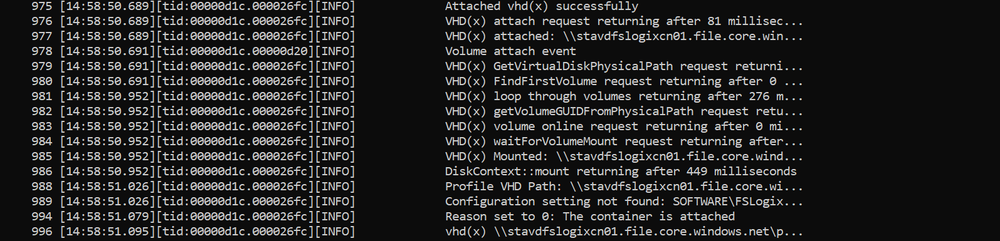
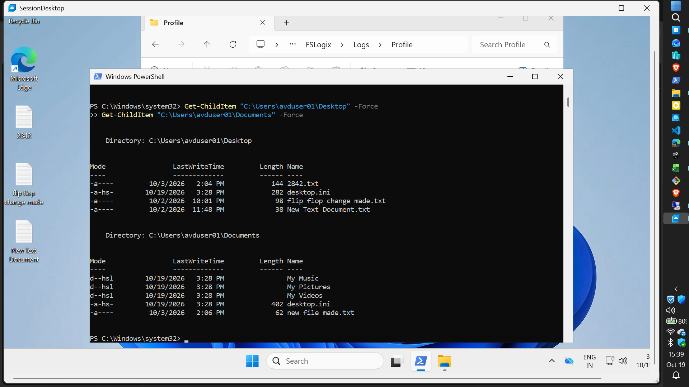
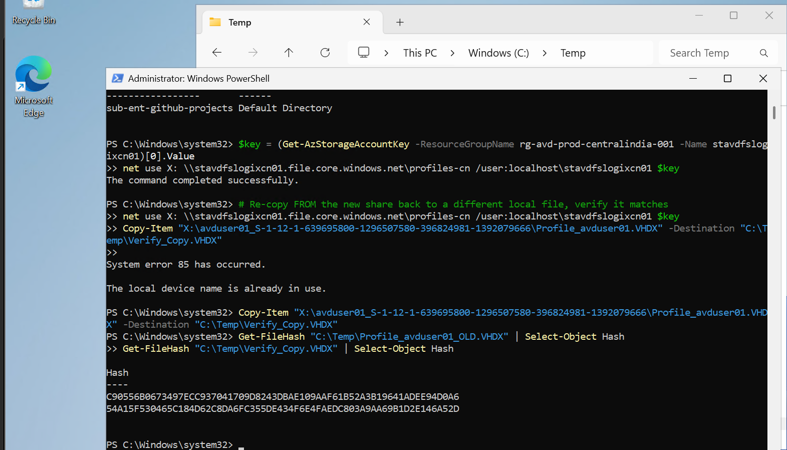

# Phase 13: Cloud-native identity migration and FSLogix profile recovery

**Status:** Completed. This phase surfaced four distinct, real issues — a missing
VM-scope RBAC role, a profile left stranded on a legacy AD-based storage account
after identity conversion, a failed container-to-container copy, and a corrupted
container caused by a now-documented FSLogix anti-pattern. Each is documented in
full in `docs/phase-15-troubleshooting/README.md`, Issues 8 through 11. This README
describes the final, working state and the real path taken to get there.

## Objective

Migrate `avduser01` from a hybrid (on-prem AD-synced) identity to cloud-only Entra
ID, ahead of Phase 14's DC-off validation test, with sign-in and FSLogix profile
continuity confirmed end-to-end under the new identity model.

## Prerequisites

- Phases 9 through 12 complete. This phase depends on Phase 10's cloud-native
  storage account (AADKERB) and Phase 11's Entra-joined session host — nothing here
  recreates those.

## Resources

| Resource | Name | Notes |
|---|---|---|
| Migrated user | avduser01 | Object ID `2620fbb8-22bc-4d47-9511-a7173273f952` |
| Control user | avduser02 | Deliberately left hybrid/unmigrated — Phase 14 control group |
| Identity group | GRP-CN-AVD-USERS | Object ID `ba5d6dd4-4ec2-4f56-a6ad-661566eceecd` |
| New storage account | stavdfslogixcn01 | AADKERB, share `profiles-cn` |
| Legacy storage account | stavdfslogixprod012842 | AD-based identity, held the original VHDX |
| Session host | vm-avd-host-1 | Entra-joined only, from Phase 11 |

## Deviations from the original plan

1. **The on-prem-to-cloud identity conversion used OU-exclusion from Entra Connect
   sync scope, which caused an unintended soft-delete** rather than a clean
   conversion. The object was recovered via `Restore-MgDirectoryDeletedItem`
   (same Object ID preserved, sync automatically left disabled). This is now a
   documented finding, not a repeatable step: OU-exclusion-only de-scoping is not a
   safe conversion method for this tenant's Entra Connect configuration, and any
   future conversion should assume soft-delete recovery may be needed.
2. **Sign-in failed after conversion with an opaque `0xc000006d`/`0xc0000022`
   Negotiate-fallback error**, requiring an extensive diagnostic chain before the
   real cause — a second, separate RBAC role (`Virtual Machine User Login` at
   VM/resource-group scope, distinct from `Desktop Virtualization User` on the app
   group) — was identified from a Microsoft Learn documentation comparison rather
   than discovered by trial and error. Full ruled-out list in Issue 8.
3. **The original profile VHDX did not migrate with the identity.** It remained on
   a separate, legacy storage account (`stavdfslogixprod012842`) still configured
   for on-premises AD-based identity — architecturally unreachable by a cloud-only
   identity with no on-prem Kerberos ticket. This was not anticipated in the
   original migration plan, which assumed the profile would simply "follow" the
   user. Full diagnostic path, including the decisive Entra sign-in log check that
   ruled out every network/identity layer first, in Issue 9.
4. **A direct VHDX container copy between the two storage accounts produced a file
   matching the source in size but failing a SHA-256 hash comparison** —
   confirmed corruption, cause not fully isolated (in-transit vs. pre-existing).
   Whole-container copies across storage accounts are now treated as untrustworthy
   without a mandatory post-copy hash check. Detail in Issue 10.
5. **A subsequent attempt to populate a fresh container by mounting it locally and
   copying files in directly (while the container was not part of an active
   FSLogix-managed session) produced a reproducible `ValidateRegistryImportFile
   failed` / `ErrorCode 13` on every following attach.** This is now a confirmed,
   standing finding, not a one-off: editing a FSLogix container's contents outside
   a live, authenticated user session invalidates the container's embedded
   registry hive state, even though the files themselves remain intact and visible
   at the filesystem level. Full detail, including why this is distinct from
   ordinary disk corruption, in Issue 11.

## Steps actually run (final, working sequence)

1. `avduser01` converted to cloud-only; soft-delete recovered via
   `Restore-MgDirectoryDeletedItem` (Deviation 1); on-prem AD object separately
   disabled and tagged.
2. `New-AzRoleAssignment -RoleDefinitionName "Virtual Machine User Login"` applied
   to `GRP-CN-AVD-USERS` at resource-group scope (Deviation 2); sign-in confirmed
   via `dsregcmd /status` showing `AzureAdPrt: YES`, `CloudTgt: YES`.
3. Original profile located on the legacy storage account; its on-prem AD identity
   model confirmed via `AzureFilesIdentityBasedAuth` (Deviation 3).
4. Original VHDX mounted locally (read-only) via `Mount-DiskImage`; source files
   confirmed present.
5. Container-to-container copy attempted and rejected after hash verification
   (Deviation 4) — not reused.
6. Corrupted container from the subsequent offline-injection attempt (Deviation 5)
   deleted outright; FSLogix allowed to auto-provision a genuinely fresh container
   on next sign-in.
7. Recovered files staged on the new share; copied into the profile **through
   avduser01's own live, authenticated session** — not by mounting the container
   again.
8. Full sign-out/sign-in cycle performed to force a real FSLogix save-and-reattach.

## Verification

```powershell
# Sign-in confirmation
dsregcmd /status
# Expect: AzureAdPrt : YES, CloudTgt : YES

# RBAC confirmation
Get-AzRoleAssignment -Scope "/subscriptions/<sub>/resourceGroups/<rg>" |
    Where-Object { $_.ObjectId -eq "<GRP-CN-AVD-USERS-object-id>" }

# FSLogix attach confirmation — check the actual log, not just sign-in success
Get-Content "C:\ProgramData\FSLogix\Logs\Profile\Profile-*.log" -Tail 60 |
    Select-String "Attached vhd|LoadProfile successful|ValidateRegistryImportFile|ErrorCode"
```

**Actual result:** FSLogix log shows a clean cycle with no validation errors:
```
Attached vhd(x) successfully
LoadProfile successful.
```
All four original files (`2842.txt`, `flip flop change made.txt`,
`New Text Document.txt`, `new file made.txt`) confirmed present via
`Get-ChildItem` and persistent across a full sign-out/sign-in cycle.

## Evidence checklist

- [x] 
  
- [x] 
  
- [x] 
  
- [x] 
  
- [x] 

## Outcome

Phase 13 completed with both the sign-in and FSLogix issues fully resolved, original
user data recovered, and persistence confirmed through a genuine FSLogix log cycle
rather than assumed from a single successful-looking session. The two most valuable
lessons, both backed by direct log evidence rather than assumption:

(1) Entra-joined AVD sign-in requires two separate RBAC grants — `Desktop
Virtualization User` on the app group and `Virtual Machine User Login` at VM/RG
scope — and missing the second produces an error that is indistinguishable from
deep identity corruption without this specific knowledge; and

(2) FSLogix containers must only ever be modified through a live, authenticated
user session — an offline mount-and-edit, even a simple file copy, corrupts the
container's registry hive validation in a way that is invisible at the filesystem
level and surfaces only as an opaque `ErrorCode 13` on the next attach. This was
discovered directly through a reproducible failure, not inferred from documentation,
and is now carried forward as a standing operational rule for all future phases.


