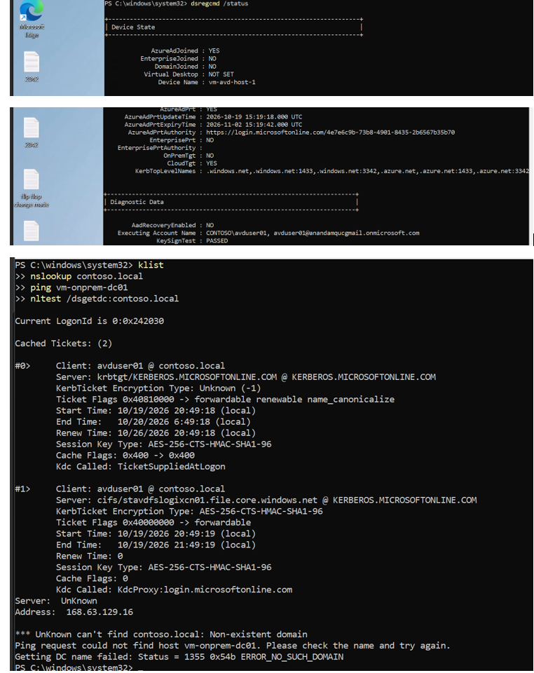
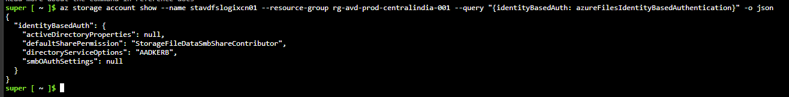
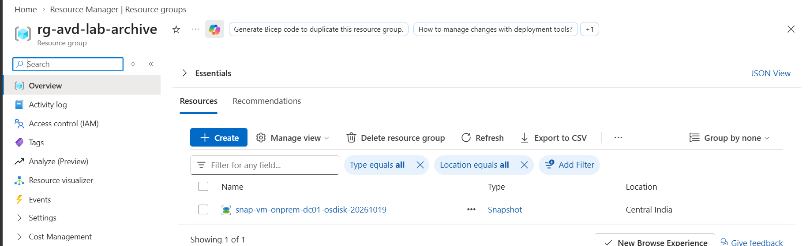

# Phase 14 — AD Retirement & Final Cloud-Native Validation

**Status:** Complete
**Date:** 2026-10-19 – 2026-10-20

## Objective

Deallocate the on-prem domain controller (`vm-onprem-dc01`) and validate that the cloud-native identity, profile, and security-automation pipeline built across Phases 9–13 survives with zero live dependency on it. A hybrid, unmigrated control account (`avduser02`) is kept in the loop deliberately, to document what breaks when a hybrid identity loses its on-prem source.

## Pre-work: Dependency Check

Before touching the DC, every network path that could still reference it was audited across both resource groups:

| Check | Result |
|---|---|
| Hub VNet (`vnet-onprem-prod-01`) DHCP DNS | Found set to `10.100.1.4` (the DC's IP) — fixed |
| Spoke VNet (`vnet-spoke-avd-prod-01`) DHCP DNS | Clear |
| `vm-onprem-dc01-nic` | Clear |
| `vm-avd-host-0-nic`, `vm-avd-host-1VMNic` | Clear (host-1 on Azure DNS `168.63.129.16` per Phase 11) |
| Private DNS zones (both RGs) | None exist |

Fix applied:
```bash
az network vnet update -g rg-onprem-prod-centralindia-001 -n vnet-onprem-prod-01 --dns-servers ""
```

## Rollback Safety Net

A managed-disk snapshot of the DC's OS disk was taken before deallocation, retained permanently as the rollback artifact:

```bash
az snapshot create -g rg-onprem-prod-centralindia-001 \
  -n snap-vm-onprem-dc01-osdisk-20261019 \
  --source vm-onprem-dc01_OsDisk_1_f640d7d315aa4772a39bd2f727bb75fc
```

## DC-Off Test Matrix

| # | Test | Expected | Result |
|---|---|---|---|
| 1 | avduser01 sign-in (cloud-native, host-1) | Pass | **PASS** |
| 2 | avduser02 identity ops (hybrid control) | Fail | **PASS** (failed as expected) |
| 3 | FSLogix mount, negative case | Fail | **Resolved analytically** |
| 4 | App Attach | — | **N/A** |
| 5 | Sentinel/SOAR automation | Still automatic | **PASS** |

### Test 1 — avduser01 (cloud-native)

```powershell
dsregcmd /status
```
`AzureAdJoined: YES` · `DomainJoined: NO` · `OnPremTgt: NO` · `CloudTgt: YES` — zero on-prem binding at the device layer.

```powershell
klist
```
Only tickets present are `krbtgt` and `cifs/stavdfslogixcn01...`, both issued by `KERBEROS.MICROSOFTONLINE.COM` — Azure AD Kerberos only, no real on-prem KDC ticket exists.

```powershell
nslookup contoso.local
ping vm-onprem-dc01
nltest /dsgetdc:contoso.local
```
All three fail outright (`Non-existent domain`, unreachable host, `ERROR_NO_SUCH_DOMAIN`) — DC is genuinely gone from this host's perspective, not just unresponsive.

FSLogix registry confirms active cloud profile redirection (`VHDLocations: stavdfslogixcn01.file.core.windows.net`, `Enabled: 1`).

### Test 2 — avduser02 (hybrid control)

Identity confirmed hybrid-synced via direct Graph v1.0 query (the older `az ad user show` CLI surface unreliably returns `onPremisesSyncEnabled: null` — don't trust it):

```bash
az rest --method GET \
  --url "https://graph.microsoft.com/v1.0/users/d8429ede-2379-4f98-89fb-75fa77ad5b46?\$select=userPrincipalName,onPremisesSyncEnabled,onPremisesImmutableId,onPremisesDistinguishedName"
```
Returns `onPremisesSyncEnabled: true`, a populated `onPremisesDistinguishedName`, and `onPremisesImmutableId` — confirmed hybrid.

Password reset attempted both via portal and CLI; both fail. CLI gives a clean, authoritative error:
```bash
az ad user update --id d8429ede-2379-4f98-89fb-75fa77ad5b46 --password '<temp>' --force-change-password-next-sign-in true
# Error Code: 120013
```
`120013` is Entra's on-premises write-back sync failure — fires when a PTA/PHS-with-writeback account tries to propagate a password change to on-prem AD and the DC is unreachable. This is stronger, more unambiguous evidence of broken hybrid dependency than a simple failed sign-in would have been.

### Test 3 — FSLogix negative case

Resolved analytically rather than via live test:
```bash
az storage account show --name stavdfslogixcn01 -g rg-avd-prod-centralindia-001 \
  --query "{identityBasedAuth: azureFilesIdentityBasedAuthentication}"
```
`directoryServiceOptions: AADKERB`, `activeDirectoryProperties: null` — the profile share itself has zero on-prem AD dependency architecturally. avduser02 never reaches this step at all; it fails upstream at sign-in/password (Test 2) before FSLogix auth is ever attempted.

### Test 4 — App Attach

**Dropped.** Per Phase 12, App Attach import never reached a working state (`Import-AzWvdAppAttachPackageInfo` blocked, documented known limitation — see `troubleshooting.md`). There is no functioning mount to validate against a DC-off scenario.

### Test 5 — Sentinel/SOAR automation

Pre-check confirmed no drift since Phase 12:
```bash
az sentinel alert-rule list -g rg-avd-prod-centralindia-001 --workspace-name law-avd-secops-001
# DET-AVD-Repeated-Failed-SignIns: enabled
az logic workflow show -g rg-avd-prod-centralindia-001 -n la-avd-soc-001
# state: Enabled
```

Triggered live: 3× failed sign-in as avduser01 on host-1, DC fully offline throughout.

```kql
SecurityIncident
| where TimeGenerated > ago(30m)
| project IncidentNumber, Title, Status, Classification, CreatedTime, LastModifiedTime
```
Incident #12: `New` (03:37:20 UTC) → `Closed / FalsePositive` (03:37:38 UTC) — **18 seconds end-to-end**, zero manual intervention. Matches Phase 12 behavior exactly.

## Scope Items Dropped

- **CCDLocations check** — originally scoped around verifying App Attach's CimFS mount staging had no stale on-prem fallback path. Since App Attach never reached a working state (Test 4), there is no mount to inspect; performing this check would validate nothing.
- **SID remediation tooling** — Phase 13 found a cosmetic-only issue (stale `CONTOSO\` display-name artifacts in SID cache resolution for avduser02). No functional impact; decided not worth building dedicated tooling for at this project scope.

## Deviations From Plan

1. Dependency check surfaced a real, previously-undocumented issue (hub VNet DHCP DNS still pointing at the DC) — not anticipated going in, caught by the systematic pre-check rather than discovered mid-test.
2. Test 2 was validated via password-reset failure (`120013`) rather than a live sign-in attempt — a stronger and more unambiguous proof point for hybrid dependency, and avoided the need to actually recover avduser02's credentials.
3. Test 4 (App Attach) was dropped entirely once Phase 12's actual conclusion was re-verified against its source README — an earlier internal summary of Phase 12 had incorrectly stated App Attach was resolved; it was not.

## Evidence

- [x] 

- [x] 

- [x] 
                                    

## Teardown (post-validation)

- [x]  


- [x] [Final Rundown Video](../14-ad-retirement-&-final-cloud-native-validation/Phase14-final-rundown.mp4)
 


***CONCLUDED*** 
