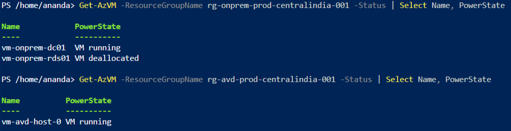
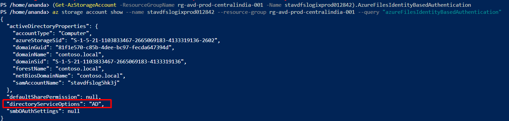
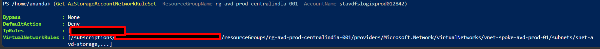
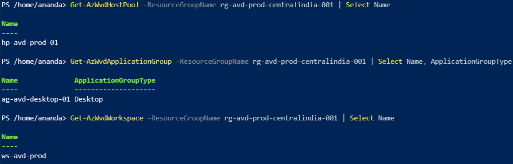
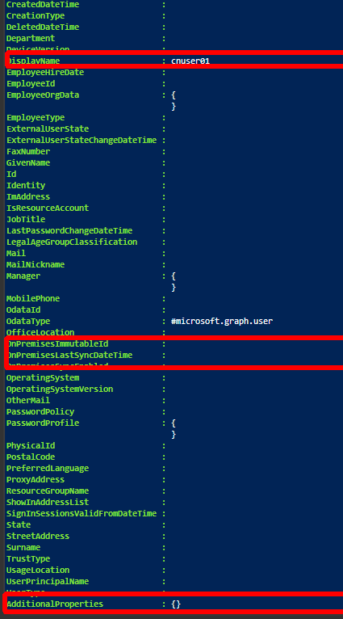
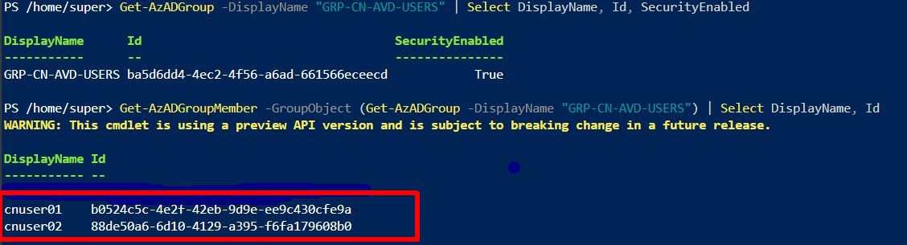
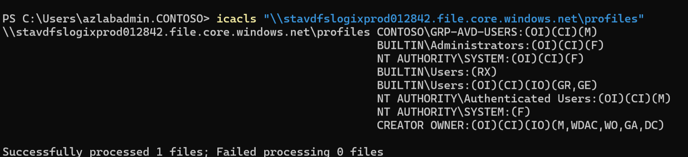
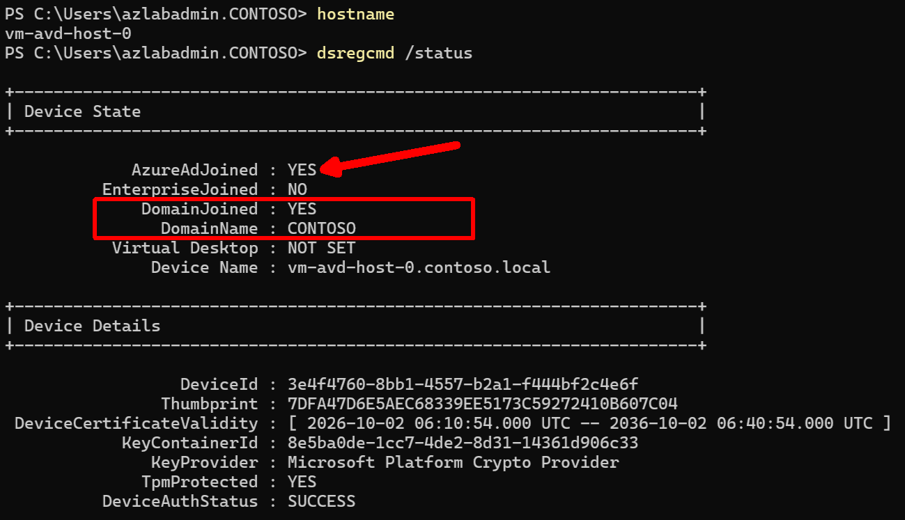
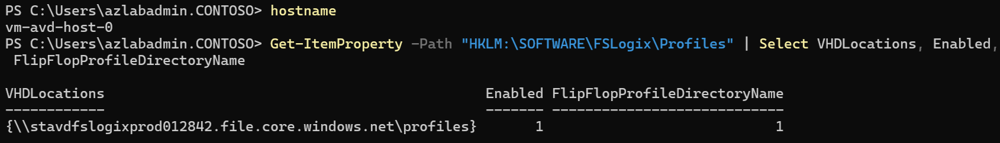
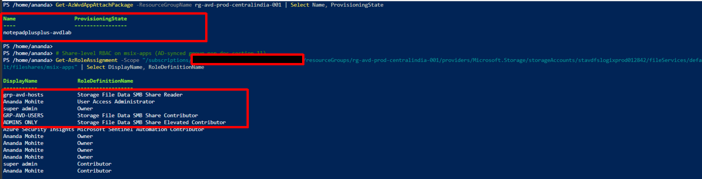

# Phase 9: Cloud-native identity & dependency preflight

## Objective
Discovery and evidence only — no resource changes, no storage authentication switch, no VM redeployment, no deletion. Identify every remaining dependency on on-premises AD DS before converting Azure Files and AVD to cloud-native in Phase 10, and establish the cloud-only identity baseline (test users and groups) that Part 2 will prove out.

## Prerequisites
- Phases 1-8 complete and evidenced (Part 1, hybrid migration).
- Entra ID P2 trial expired — no further Conditional Access or PIM work in scope; this phase does not require P2.
- `Az` PowerShell modules (`Az.Accounts`, `Az.Compute`, `Az.Storage`, `Az.DesktopVirtualization`, `Az.Resources`) and Azure CLI available.

## Steps

### 9.1 — Current Azure resources and AVD state
Confirm live resource state against the master architecture doc rather than assuming it's current.
```powershell
Get-AzVM -ResourceGroupName rg-onprem-prod-centralindia-001 -Status | Select Name, PowerState
Get-AzVM -ResourceGroupName rg-avd-prod-centralindia-001 -Status | Select Name, PowerState
Get-AzStorageAccountNetworkRuleSet -ResourceGroupName rg-avd-prod-centralindia-001 -AccountName stavdfslogixprod012842
Get-AzWvdHostPool -ResourceGroupName rg-avd-prod-centralindia-001 | Select Name
Get-AzWvdApplicationGroup -ResourceGroupName rg-avd-prod-centralindia-001 | Select Name, ApplicationGroupType
Get-AzWvdWorkspace -ResourceGroupName rg-avd-prod-centralindia-001 | Select Name
Get-AzSentinelAutomationRule -ResourceGroupName rg-avd-prod-centralindia-001 -WorkspaceName law-avd-secops-001 | Select DisplayName
```

### 9.2 — User and identity model
Confirm the existing production users are AD-synced hybrid identities, then stand up a cloud-only identity baseline for Part 2.
```powershell
Get-AzADUser -UserPrincipalName "avduser01@anandamqucgmail.onmicrosoft.com" -Select "onPremisesSyncEnabled,onPremisesSecurityIdentifier,onPremisesDomainName" | fl *
```
Create the cloud-only test identities (Entra portal or Graph — no AD DS object created, no sync):
- Users: `cnuser01`, `cnuser02`
- Group: `GRP-CN-AVD-USERS` (membership: cnuser01, cnuser02)

Verify no on-prem shadow exists:
```powershell
Get-AzADUser -UserPrincipalName "cnuser01@anandamqucgmail.onmicrosoft.com" -Select "displayName,onPremisesSyncEnabled,onPremisesSecurityIdentifier" | fl *
Get-AzADGroupMember -GroupObject (Get-AzADGroup -DisplayName "GRP-CN-AVD-USERS") | Select DisplayName, Id
```

### 9.3 — Azure Files authentication and permissions (AD baseline)
Capture the current AD-Kerberos share config and NTFS ACLs as the "before" state, from a domain-joined host (`vm-avd-host-0`) — not Cloud Shell, which fails storage data-plane calls here on both network (firewall `Deny`) and identity (Cloud Shell's MSI has no SMB share RBAC) grounds.
```powershell
icacls "\\stavdfslogixprod012842.file.core.windows.net\profiles"
```

### 9.4 — Session host and FSLogix (join state, profile path)
From `vm-avd-host-0`:
```powershell
dsregcmd /status
Get-ItemProperty -Path "HKLM:\SOFTWARE\FSLogix\Profiles" | Select VHDLocations, Enabled, FlipFlopProfileDirectoryName
```

### 9.5 — MSIX and application dependencies
```powershell
Get-AzWvdAppAttachPackage -ResourceGroupName rg-avd-prod-centralindia-001 | Select Name, ProvisioningState
Get-AzRoleAssignment -Scope "/subscriptions/41a2b403-5b13-4a58-8cc0-c3ec75dba78a/resourceGroups/rg-avd-prod-centralindia-001/providers/Microsoft.Storage/storageAccounts/stavdfslogixprod012842" | Select DisplayName, RoleDefinitionName
```

### 9.6 — Dependency decision and Phase 10 gate
Consolidated AD DS dependency list and GO/NO-GO call for Phase 10.

## Verification
- `vm-onprem-dc01`: running. `vm-onprem-rds01`: deallocated.
- `stavdfslogixprod012842.AzureFilesIdentityBasedAuthentication.directoryServiceOptions` = `AD`.
- Storage firewall: `DefaultAction: Deny`, VNet rule on `snet-avd-storage`; one stale IP rule flagged for Phase 14 cleanup.
- `hp-avd-prod-01`, `ag-avd-desktop-01` (Desktop type), `ws-avd-prod` exist. `ag-avd-remoteapp-01` was planned only, not built.
- Sentinel automation rule `AUTO-AVD-FailedSignIn-SOAR` exists as planned.
- `avduser01` / `avduser02`: `onPremisesSecurityIdentifier` populated (domain SID `S-1-5-21-1103833467-2665069183-4133319136`, RID 1104/1105) — confirmed hybrid.
- `cnuser01` / `cnuser02`: `onPremisesSecurityIdentifier` empty — confirmed cloud-only.
- `GRP-CN-AVD-USERS` created, both cloud-only users as members.
- NTFS ACL on `profiles` share: `CONTOSO\GRP-AVD-USERS:(M)` — matches architecture doc, no drift.
- `vm-avd-host-0`: `AzureAdJoined: YES`, `DomainJoined: YES`, domain `CONTOSO` — hybrid-joined, confirmed not reusable as the cloud-native proof host.
- FSLogix: `VHDLocations = \\stavdfslogixprod012842...\profiles`, `Enabled = 1`, `FlipFlopProfileDirectoryName = 1`.
- App Attach package `notepadplusplus-avdlab` present; `msix-apps` access via `grp-avd-hosts` (AD-synced) = SMB Share Reader — inherits the Phase 10 storage migration, no separate fix needed.

## Decision
**GO** for Phase 10. All AD DS dependencies identified (storage identity source, hybrid users/groups, hybrid-joined host, NTFS ACL model, spoke DNS, GPOs). Rollback is low-risk: new storage account and new host pool mean Part 1 stays untouched regardless of Part 2 outcome. `avduser01`/`avduser02` are intentionally left hybrid as the Phase 13 DC-off control group; `cnuser01`/`cnuser02` are the cloud-native proof identities. A live migration of `avduser01` to cloud-only (same UPN, FSLogix data carried over, new SID — SID continuity is not achievable in Entra ID) is folded into Phases 11-12 rather than Phase 9.

## Evidence checklist
- [x] 
  
- [x]  (CLI output)
  
- [x] 
  
- [x] 
  
- [x] 
  
- [x] 
  
- [x] 
  
- [x] 
  
- [x] 
  
- [x] 
