Title: App Attach import fails with "Failed to retrieve access keys for storage accounts" on Entra-joined-only host pool — structural, not RBAC (13 causes ruled out)

Severity: B — Moderate business impact (lab/dev, non-production)

Service: Azure Virtual Desktop

Problem type: App Attach

Subscription / Resource details:

•	Host pool: hp-avd-prod-02 (Entra-ID-joined-only, no hybrid join), resource group rg-avd-prod-centralindia-001, region Central India

•	Session host: vm-avd-host-1 (D2s_v5, Entra joined only)

•	App group: ag-avd-desktop-02, workspace ws-avd-prod

•	Storage accounts tested: stavdfslogixcn01 (AADKERB) and stavdfslogixprod012842 (legacy AD-based) — same error on both

Summary:

Import-AzWvdAppAttachPackageInfo fails identically regardless of storage account, entry method (PowerShell cmdlet vs portal wizard), or any of 13 independently tested permission/network/identity fixes. Error is byte-identical in every case:

Import-AzWvdAppAttachPackageInfo_ImportExpanded: ActivityId: <varies>

Error: The MSIX Application metadata expand request failed on all Session Hosts that it was sent to.

Session Host: vm-avd-host-1

Error: StorageAccountAccessKeyServiceImpl - AttemptAADAppAttachWorkflowAsync: Failed to retrieve access keys for storage accounts. Cannot proceed with AAD app attach workflow.

Repro steps:
1.	Entra-joined-only AVD host pool with a session host that has no hybrid join
2.	Grant "Reader and Data Access" RBAC to both Azure Virtual Desktop and Azure Virtual Desktop ARM Provider first-party SPs at storage account scope (confirmed present via Get-AzRoleAssignment)
3.	Run: 
```
Import-AzWvdAppAttachPackageInfo -HostPoolName hp-avd-prod-02 -ResourceGroupName rg-avd-prod-centralindia-001 -Path "\\<account>.file.core.windows.net\<share>\<app>\<app>.vhdx"
```
**4.	Error occurs consistently, on first attempt and every retry**


Isolation testing performed (13 independent fixes/checks, all ruled out, error unchanged byte-for-byte):

1. The core error (capture 2-3 times across different attempts)

PowerShell window showing full output of:
```
Import-AzWvdAppAttachPackageInfo -HostPoolName hp-avd-prod-02 -ResourceGroupName rg-avd-prod-centralindia-001 -Path "\\<account>.file.core.windows.net\<share>\<app>\<app>.vhdx"
```

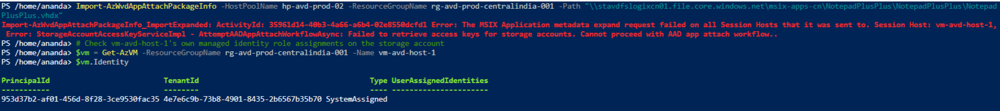

---

2. RBAC — AVD service principals

```
Get-AzRoleAssignment -Scope "/subscriptions/<sub>/resourceGroups/rg-avd-prod-centralindia-001/providers/Microsoft.Storage/storageAccounts/stavdfslogixcn01" | Where-Object {$_.DisplayName -like "*Virtual Desktop*"}
```
Screenshot showing both SPs with “Reader and Data Access” only.

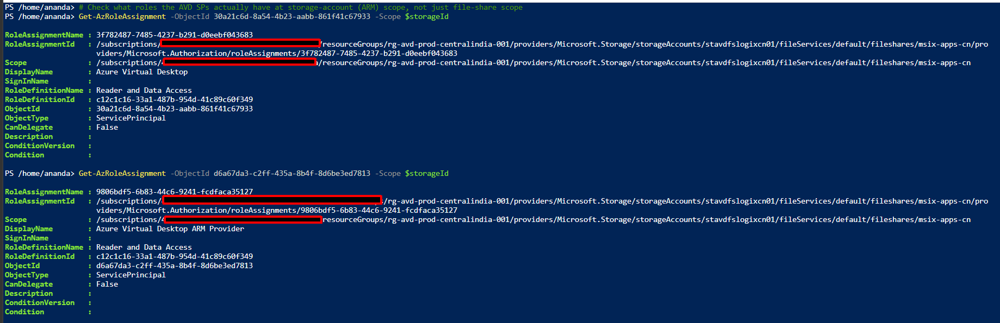

---
3. RBAC — host VM managed identity

```
Get-AzRoleAssignment -ObjectId 953d37b2-af01-456d-8f28-3ce9530fac35
```
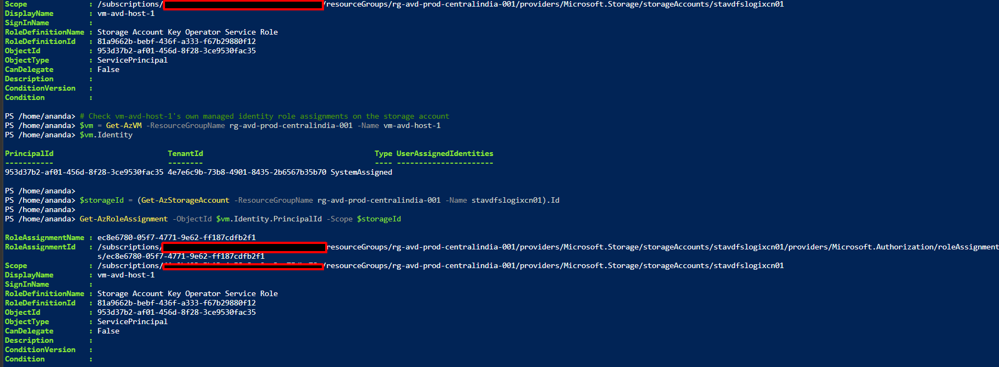
---

4. RBAC — admin user

```
Get-AzRoleAssignment -SignInName "email-id" -Scope "/subscriptions/<sub>/resourceGroups/rg-avd-prod-centralindia-001/providers/Microsoft.Storage/storageAccounts/stavdfslogixcn01"
```
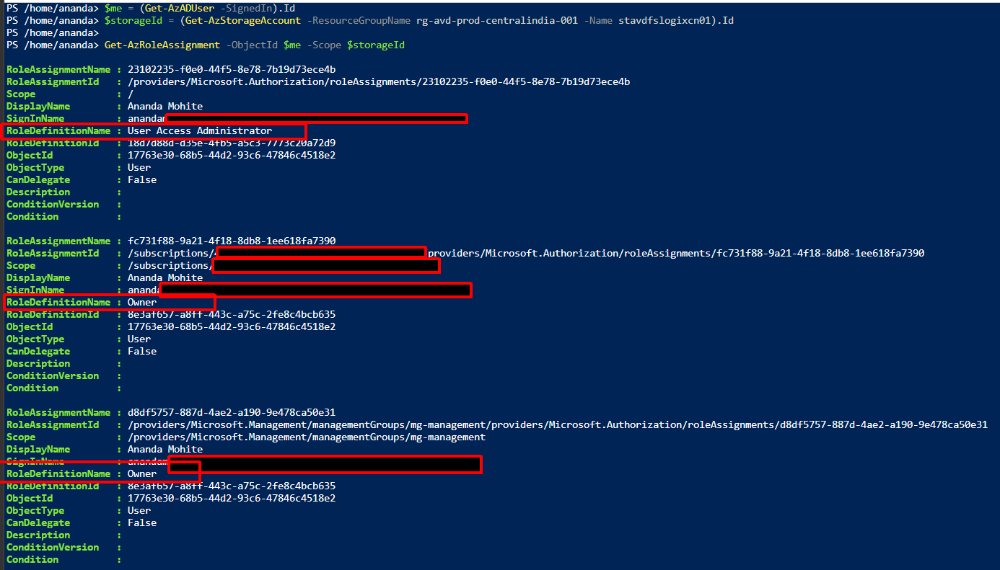
---
5. Firewall configs (both states)

Portal: Networking blade on stavdfslogixcn01, showing AzureServices bypass
Portal/CLI: same blade, DefaultAction=Allow (fully open)
```
az storage account show -n stavdfslogixcn01 -g rg-avd-prod-centralindia-001 --query networkRuleSet
```
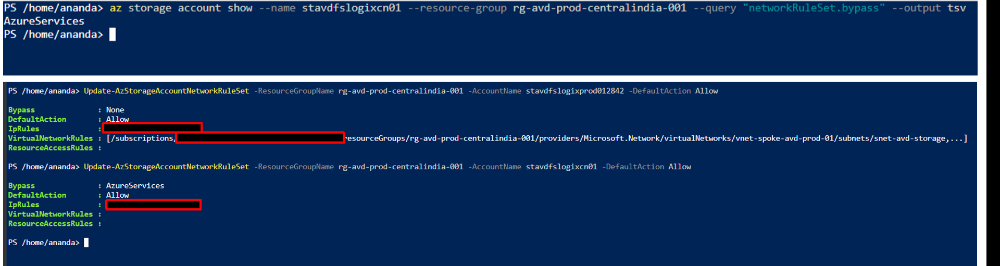
---
6. Shared key access setting

```
az storage account show -n stavdfslogixcn01 -g rg-avd-prod-centralindia-001 --query allowSharedKeyAccess
```
(Captured both before and after forcing true)

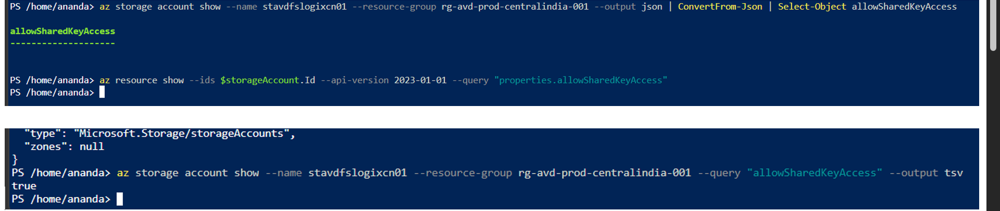

---
7. Portal wizard — UNC input path, same error
Screenshot of portal App Attach “Create” wizard with UNC path entered, showing the identical “Failed to retrieve access keys” error.
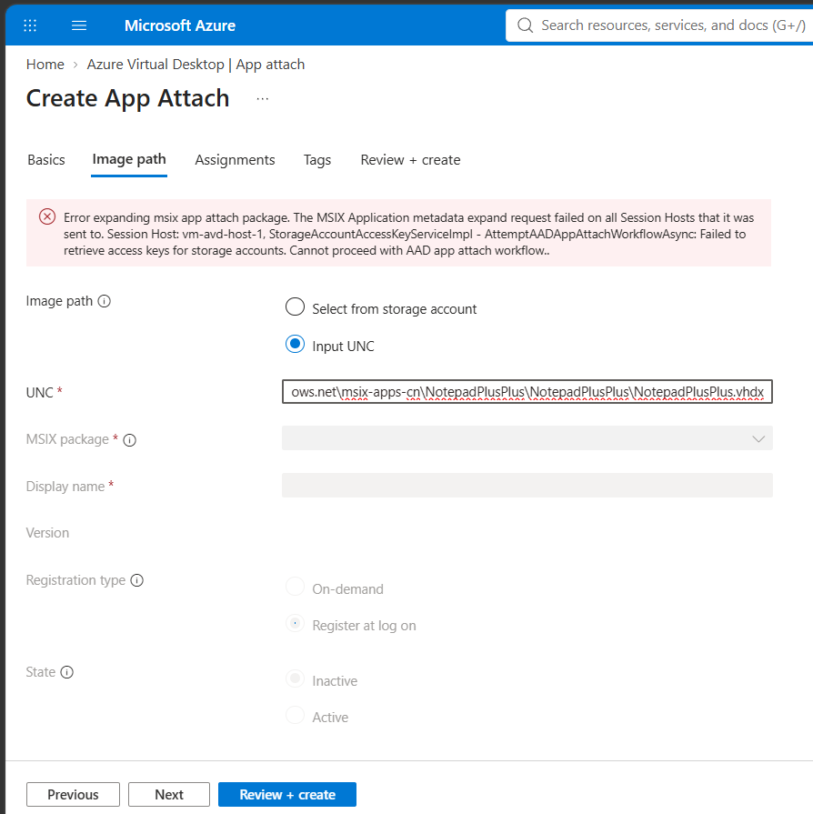
---
8. Portal wizard — separate 401 (file-picker bug)

Screenshot of the HTTP 401 JSON toast, and DevTools Network tab showing the 403 AuthorizationFailure call to ?restype=directory&comp=list.
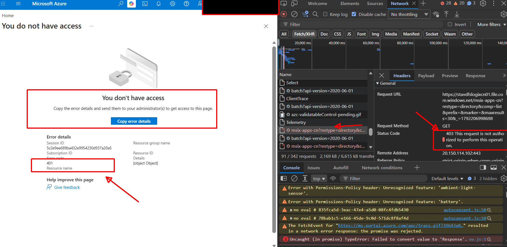
---
9. Host device object + group RBAC

```
Get-MgDevice -DeviceId <deviceId>
Get-AzADGroupMember -TargetGroupObjectId f91c367d-266d-463c-b860-bd4150838d3a
Get-AzRoleAssignment -ObjectId f91c367d-266d-463c-b860-bd4150838d3a
```
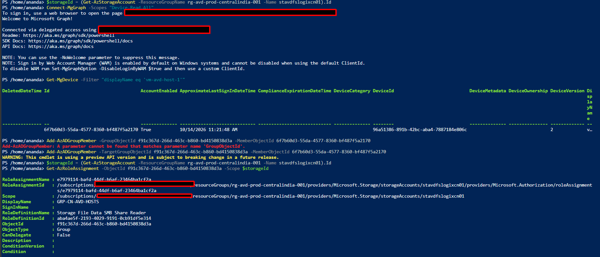
---
10. Module version

```
Get-Module Az.DesktopVirtualization -ListAvailable | Select Name, Version
```
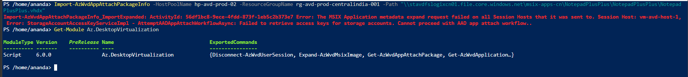
---

11. PRT/Kerberos health on host
```
dsregcmd /status
klist
Captured for cnuser02 session — showing AzureAdPrt: YES, CloudTgt: YES.
```

---

12. Portal vs PowerShell — same underlying failure

Side-by-side: PowerShell error + portal UNC-input error, same Session Host, same core message.
---
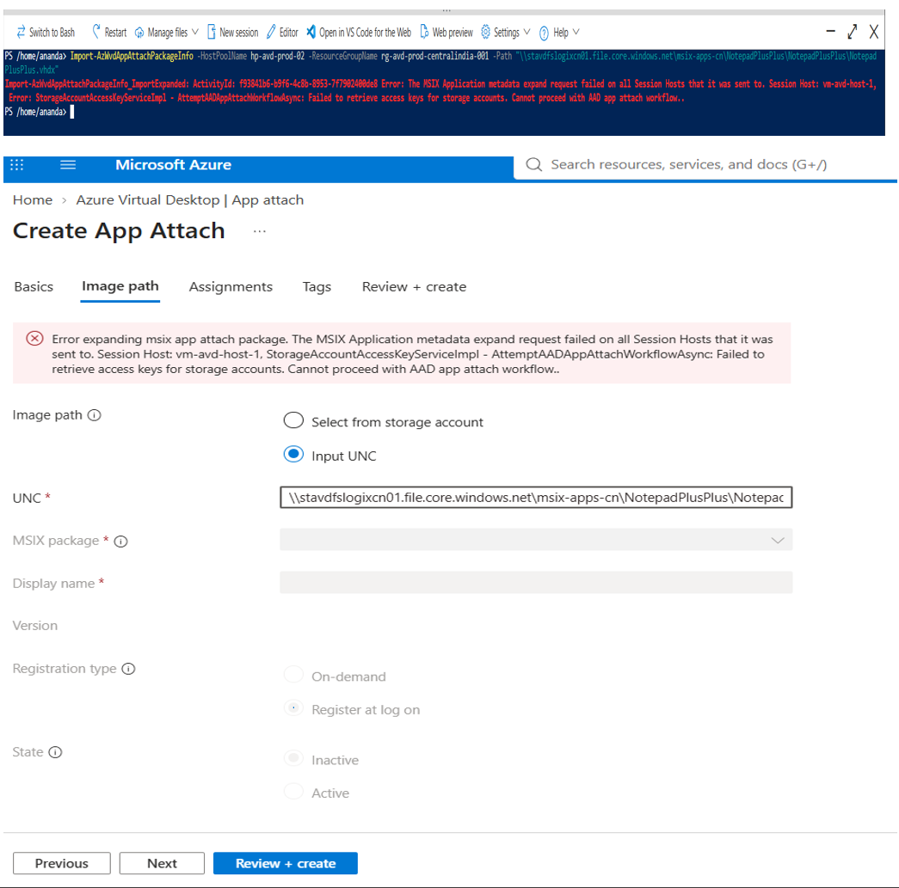

13. Two-storage-account isolation test

PowerShell output of the import run against stavdfslogixprod012842, same VHDX, same error text.

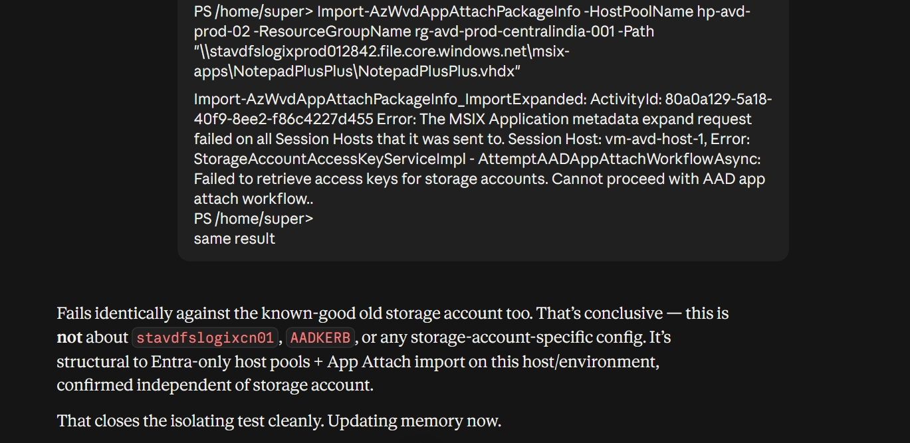

14. Activity Log — caller identity correction

```
Get-AzActivityLog -ResourceId $storageAccountId -StartTime (Get-Date).AddDays(-2) |
    Where-Object { $_.OperationName.Value -like "*listKeys*" } |
    Select-Object EventTimestamp, Caller, OperationName, Status, CorrelationId
```

Screenshot of the full output showing Caller: "email-id" on every entry.


**Conclusion from isolation testing:**

***The failure is independent of storage account configuration, RBAC on all four identity types tested (host VM managed identity, AVD service principals, admin user, host device/computer object), firewall configuration, shared-key-access setting, and module version. This points to either a platform-level issue specific to App Attach import on Entra-joined-only (non-hybrid) host pools, or an undocumented requirement not covered in current MS Learn documentation.***

**Question for support??**

***Is App Attach import (Import-AzWvdAppAttachPackageInfo / portal expand step) supported end-to-end on a host pool where the session host is Microsoft Entra-joined only (no hybrid join, no AD DS, no Entra Domain Services)? If supported, what identity does the expand/import step actually authenticate as, and what grant is missing?***