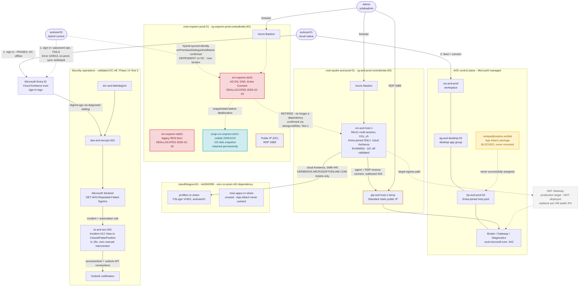

## Architecture
# As-built architecture: Part 2 (cloud-native, Phases 9-14) — final state

**Legend:** dashed grey node = target, not deployed. Orange nodes = public IPs
(inbound RDP exposure). Red nodes = deallocated (DC, RDS01). Blue node = permanent
snapshot artifact. Yellow node = documented blocked feature (App Attach).

The DC-to-host dependency from Part 1 is now **retired**, not live — Phase 14
confirmed via `dsregcmd`/`klist` that avduser01's sign-in, FSLogix mount, and the
Sentinel/SOAR pipeline all function with the DC fully offline. The dashed line from
avduser02 to the DC shows the one dependency that's still real: a hybrid identity's
password/sync operations, which now fail (`Error 120013`) with no source DC to
write back to — this is the expected, documented outcome for the control account,
not a defect.

Region: Central India. Resource names match the Azure Resource Visualizer export.
